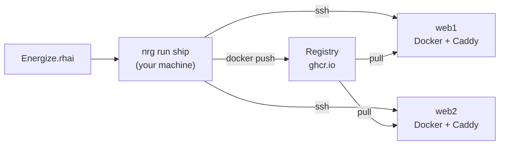

# Energize (nrg)

[](https://github.com/inou/nrgize-rs/actions/workflows/ci.yml)
[](LICENSE)

You write your deploy script in Rhai (a small scripting language), on your machine. Each function in `Energize.rhai` is a task, and you run one with `nrg run <task>`.
`nrg` reaches your servers over plain SSH, with no agent to install, and ships a standard library for zero-downtime container deploys behind Caddy (a web server that handles HTTPS for you) and for [directory releases](docs/directory-releases.md) (upload a folder, switch to it, roll back instantly).



## Installation

Install the latest release with the script:

```bash
curl -fsSL https://raw.githubusercontent.com/inou/nrgize-rs/main/scripts/install.sh | sh
```

Or use Homebrew:

```bash
if brew help trust >/dev/null 2>&1; then brew trust --formula inou/nrg/nrg; fi
brew tap inou/nrg https://github.com/inou/nrgize-rs.git
brew install inou/nrg/nrg
```

Or build from source with Cargo:

```bash
cargo install --git https://github.com/inou/nrgize-rs
```

Check it worked with `nrg --version`. For checksums, pinning a version and the optional tools, see [Getting started](docs/getting-started.md#install).

## Your first deploy

Before you start, you need:

- A `Dockerfile` in the current directory. `nrg` builds the image on your machine.
- Docker on your machine, logged in to `ghcr.io` so it can push.
- Two servers, `web1` and `web2`, that you can reach over SSH and that have Docker installed. They must be able to pull `ghcr.io/acme/shop` (the image is public, or each host is logged in), and you must have connected to each host once so its key is in `known_hosts`.
- The name `shop.example.com` must point at both servers, and ports 80 and 443 must be free on them, so Caddy can get HTTPS certificates. See [Getting started](docs/getting-started.md) to prepare the servers.

If the image already exists, set `skip_build: true` in the config below and `nrg` will not build it.

Put this in a file called `Energize.rhai`. It deploys the image `ghcr.io/acme/shop` to two servers, `web1` and `web2`, and serves it on `shop.example.com`:

```rhai
import "std/deploy" as deploy;

fn ship(tag) {
    deploy::deploy(["web1", "web2"], "ghcr.io/acme/shop:" + tag, "shop", #{
        container_port: 3000,
        health_path:    "/up",
        domain:         "shop.example.com",
    });
}
```

List the tasks in the file. `ship` takes one argument:

```console
$ nrg tasks
Functions:
  ship (1 arg)
```

Preview the deploy before you run it:

```console
$ nrg run ship v1 --dry-run
...
PLAN (dry run — no changes made):
  lock    web1   mkdir /tmp/nrg-deploy-lock-shop (owned deploy lock) ...
  lock    web2   mkdir /tmp/nrg-deploy-lock-shop (owned deploy lock) ...
  local   -      docker build -t 'ghcr.io/acme/shop:v1' -f 'Dockerfile'  '.' ...
  local   -      docker push 'ghcr.io/acme/shop:v1' ...
  ssh-all web1   docker pull 'ghcr.io/acme/shop:v1' ...
  ssh-all web2   docker pull 'ghcr.io/acme/shop:v1' ...
  ssh     web1   docker run -d --name caddy --restart unless-stopped --network host ... ...
  ...
  ssh     web1   docker run -d --restart unless-stopped --name 'shop-web-v1-<auto>' ... ...
  ...
```

Every row in the real output ends with `[planned; execution-unverified]`. The `...` above also hides that text and the middle of long commands.

A dry run changes nothing on your servers, but it does read their current state over SSH. If it cannot reach a host, it assumes nothing is there yet, so the plan is only accurate when SSH works.

When the plan looks right, run it for real:

```bash
nrg run ship v1
```

`nrg` builds and pushes the image, pulls it on each host, sets up Caddy on each host if it is not running (it listens on ports 80 and 443), starts the new container, waits for `/up` to answer, and then switches traffic to it. If a step fails, it tries to undo the earlier ones; see [Safety and limits](docs/safety.md) for when you may need to step in.

Upgrading from 0.1.x? See the [0.2.0 notes](docs/releases/v0.2.0.md).

## Documentation

Read it online at <https://inou.github.io/nrgize-rs/>.

| Page | What it covers |
|---|---|
| [Getting started](docs/getting-started.md) | Install, prepare a server, and make your first deploy. |
| [Guides](docs/guides.md) | Writing scripts, container deploys, directory releases, secrets, dry runs and testing. |
| [CLI](docs/cli.md) | Every `nrg` command and flag. |
| [Builtins](docs/builtins.md) | The functions available in every script, such as `ssh_exec` and `http_get`. |
| [Standard library](docs/stdlib.md) | The `std/...` modules you import, such as `std/deploy`. |
| [Safety and limits](docs/safety.md) | What `nrg` guarantees, and what it does not. |

## Contributing

Read [CONTRIBUTING.md](CONTRIBUTING.md) first. For how the code is laid out, see [docs/architecture.md](docs/architecture.md).

## License

MIT. See [LICENSE](LICENSE).
