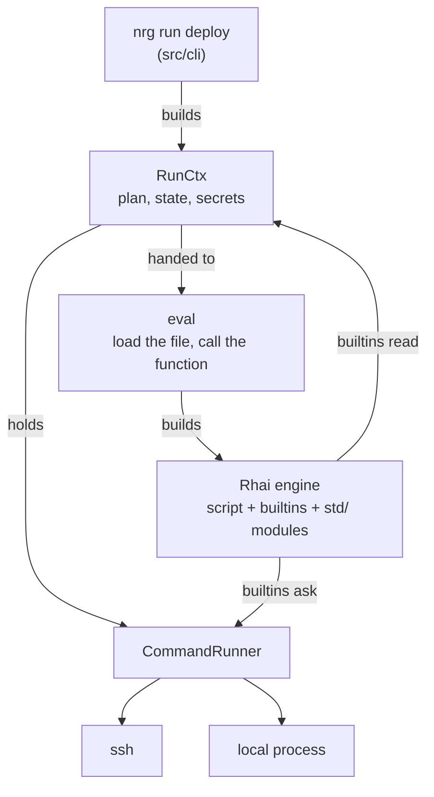

# Architecture

This page shows how `nrg` is built, so you can find the right file when you fix a bug or add a builtin.

You do not need it to write deploy scripts. For that, start with [Writing scripts](authoring.md).

## Module layout

| Path | What it does |
| --- | --- |
| `src/main.rs` | Parses the command line, writes the audit begin/end entries for `remove`, `lock`, `app`, `secrets` and `setup`, and exits with the command's exit code. |
| `src/cli/` | One file per subcommand (`run.rs`, `exec.rs`, `rollback.rs`, `doctor.rs`, ...). `exec.rs` also holds `wire_run`, which sets up a run. |
| `src/engine/mod.rs` | `build_engine()`: creates the Rhai engine and registers everything on it. |
| `src/engine/eval.rs` | Loads a script file and runs it: `run_file`, `run_fn` and `list_functions`. |
| `src/engine/context.rs` | `RunCtx`, the state shared by one `nrg` run, and `EffectMode` (live or dry run). |
| `src/engine/runner.rs` | `CommandRunner`: the one place builtins start `ssh` and local processes. |
| `src/engine/builtins/` | The functions scripts call: `exec.rs`, `transfer.rs`, `http.rs`, `probe.rs`, `state.rs`, `steps.rs`, `preflight.rs`, `util.rs`. |
| `src/engine/state.rs` | The state file `.energize/state.json`, its lock and project-root discovery. |
| `src/engine/secret.rs` | The `Secret` type, shell quoting and the redaction of output. |
| `src/engine/transaction.rs` | `transaction()` and `on_rollback()`. |
| `src/engine/types.rs` | The result types scripts see: `ExecResult` and `HttpResponse`. |
| `src/engine/interrupt.rs` | Ctrl-C and SIGTERM handling, and the exit codes 130 and 143. |
| `src/engine/journal.rs` | Writes `.energize/runs.jsonl`, the run record that `nrg audit` reads. |
| `src/engine/diagnostics.rs` | The step records of a run. |
| `src/engine/remote_lock.rs` | The lock on a remote host. |
| `src/engine/plan.rs` | The list of recorded actions and the text of the dry-run plan. |
| `src/engine/stdlib.rs` | Embeds `lib/*.rhai` in the binary and resolves `import "std/..."`. |
| `src/audit.rs` | Appends to `audit.log`. |
| `src/trust.rs` | Checks that a project folder belongs to you and is not writable by others. |
| `src/secrets/` | The age key files (`.nrg-key`) and encrypting and decrypting secret values. |
| `src/ssh/` | Parsing of `~/.ssh/config` host entries. |
| `lib/` | The standard library, written in Rhai. `lib/examples/` holds the templates for `nrg init --template`. |

## How a run flows



The CLI builds a `RunCtx` and hands it to `eval`. `eval` builds the engine around that context. Every builtin the script calls reads the same `RunCtx`. When a builtin needs to run a command, it asks the `CommandRunner`.

## Building the engine

`build_engine(ctx)` in `src/engine/mod.rs` is the only place the engine is assembled. In order, it:

1. Lifts Rhai's operation limit and expression-nesting limit, because the scripts are yours and the standard library builds long command strings. It sets the function-call depth to 64, not unlimited. A script that calls itself without end stops with `ErrorStackOverflow` instead of crashing `nrg`.
2. Sends `print` and `debug` to stderr, through secret redaction.
3. Adds a progress hook that stops the script when you press Ctrl-C.
4. Registers the result types (`ExecResult`, `HttpResponse`).
5. Registers the builtins, then the secret functions, then `transaction` and `on_rollback`.

`build_engine` does not set up `import`. `eval.rs` does that next, with `stdlib::install`:

```rust
let embedded = bootstrap_embedded(engine);
let mut collection = ModuleResolversCollection::new();
collection.push(embedded);                                   // "std/..." first
collection.push(FileModuleResolver::new_with_path(base));    // then files next to the script
engine.set_module_resolver(collection);
```

The standard library is compiled into the binary. `src/engine/stdlib.rs` has a constant `EMBEDDED` that lists each `lib/*.rhai` file with `include_str!`. The list is in dependency order: a module may only import modules above it.

Because the embedded resolver comes first, `import "std/docker" as docker;` always gives you the version that shipped with your binary. A file named `std/docker.rhai` next to your script does not replace it.

## RunCtx and shared handles

`RunCtx` (in `src/engine/context.rs`) holds everything one `nrg` run shares. Builtins get it as `SharedCtx`, which is an `Arc<RunCtx>`.

| Field | Holds |
| --- | --- |
| `mode` | `EffectMode::Live` or `EffectMode::DryRun`. Set once at the start. |
| `runner` | The `CommandRunner` that starts processes. |
| `state` | The persistent state store. |
| `session` | Values kept in memory for this run only. |
| `secrets` | The plaintext of every secret read so far, used to hide it in output. |
| `plan` | The actions a dry run recorded. |
| `txn` | The undo steps registered by `on_rollback`. |
| `steps`, `journal` | The run record behind `nrg audit` (`.energize/runs.jsonl` and `audit.log`). |
| `interrupted` | Set by the Ctrl-C handler. |

There is no big lock around `RunCtx`. Each field that changes has its own lock. A builtin holds a lock only for the moment it reads or writes, and never while it waits for `ssh`. For slow work it clones the `Arc` first (`ctx.runner.clone()`) and waits on the clone. `ssh_exec_all` relies on this: it runs the command on up to 16 hosts at once from separate threads, and none of them wait on each other.

## CommandRunner

Builtins never start a process themselves. They call the `CommandRunner` trait:

```rust
pub trait CommandRunner: Send + Sync {
    fn run_ssh(&self, host: &str, cmd: &str) -> RawOutput;
    fn run_local(&self, cmd: &str) -> RawOutput;
    // plus stdin, cleanup and streaming variants
}
```

`RealRunner` is the one used by the `nrg` binary. It runs `ssh` with `BatchMode=yes` and strict host-key checking by default (`NRG_SSH_HOST_KEY_CHECKING` changes it), and passes the host name to `ssh` unchanged, so your `~/.ssh/config` applies as usual. Local commands run through `sh -c`. The `*_stdin` variants send text on standard input, so file contents and secrets never show up in `ps`.

Tests use `FakeRunner` (compiled only for tests). It records every call as a line such as `ssh web1: uptime` and returns a canned result. A test then checks the list of calls to prove what a script would have run. No test needs a real host.

## Builtins and EffectMode

Each file in `src/engine/builtins/` has a `register` function. It calls `engine.register_fn` once per builtin, and each closure captures a clone of the `SharedCtx`:

```rust
engine.register_fn("ssh_exec", move |host: &str, cmd: &str| {
    effect(&ctx, "ssh", Some(host), &format!("ssh_exec {host}"), cmd,
           |c| to_result(host, c.runner.run_ssh(host, cmd)))
});
```

The dry run is built into these helpers in `builtins/exec.rs`, not into each builtin:

- `effect` checks the command for a leaked `Secret`, then calls `dispatch`.
- `dispatch` looks at `ctx.mode`. In a dry run it records a `PlannedAction` and returns a fake success. In a live run it calls the closure and writes a journal entry around it.
- `effect_fanout` does the same for one command on many hosts.
- `dry_run_record` and `dry_run_each` cover builtins that only need to record, such as `state_set`.

So each builtin falls in one of three groups:

| Group | In a dry run | Examples |
| --- | --- | --- |
| Changes something | Recorded in the plan, not run | `ssh_exec`, `local_exec`, `write_remote`, `upload_file`, `http_post` |
| Only reads | Runs for real. If a probe cannot run (`container_running`, `port_open`, ...), the plan notes it and the probe answers "absent" instead of throwing. | `ssh_probe`, `container_running`, `http_get`, `pick_port` |
| Bookkeeping | Handled in memory | `state_set` and `state_get` (they use an in-memory copy of the state), `sleep` (skipped) |

Nothing tracks what the plan would change. A read after a planned change still sees the host as it is now. The standard library checks `is_dry_run()` at the few places where that matters.

Here is a small script and its plan. The `echo` and the state write are recorded, and `on_rollback` records that an undo step exists:

```rhai
fn hello() {
    transaction(|| {
        ssh_exec("web1", "echo hello");
        on_rollback(|| { ssh_exec("web1", "echo undo"); });
        state_set("last", "hello");
    });
}
```

```console
$ nrg run hello --dry-run
PLAN (dry run — no changes made):
  ssh     web1                   echo hello [planned; execution-unverified]
  rollback -                      register compensation [planned; execution-unverified]
  state   -                      last = <5 bytes> [planned; execution-unverified]
3 action(s), 1 host(s). 0 executed.
...
```

You can do the same by hand. Save the script above as `Energize.rhai`, put a fake `ssh` first on your `PATH` and read its log:

```bash
mkdir -p bin
printf '#!/bin/sh\necho "ssh $*" >> calls.log\nexit 0\n' > bin/ssh && chmod +x bin/ssh
PATH=$PWD/bin:$PATH nrg run hello
cat calls.log
```

The log has one line, ending in the part you care about:

```console
ssh -o BatchMode=yes -o StrictHostKeyChecking=yes -o ConnectTimeout=10 ... -- web1 echo hello
```

See [Dry run](dry-run.md) for the user's view.

## Transactions

`transaction(body)` runs `body`. If `body` throws, `nrg` runs the undo steps that `on_rollback` registered, newest first, and then throws the original error again.

This is the unwind loop, trimmed a little:

```rust
loop {
    let comp = {
        let mut t = ctx.txn.lock().unwrap();
        if t.comps.len() > mark { t.comps.pop() } else { None }
    };                                   // the lock is released here
    match comp {
        Some(c) => if let Err(ce) = c.call_within_context::<Dynamic>(&context, ()) {
            eprintln!("[nrg] rollback step failed (continuing): {}",
                      ctx.redacted(&ce.to_string()));
        },
        None => break,
    }
}
```

The details that matter:

- The loop takes one step off the stack, releases the lock, and only then calls it. An undo step may itself call `on_rollback` or `transaction`, and would deadlock if the lock were still held.
- A step that fails is printed and the unwind goes on with the next one.
- A nested `transaction` that succeeds keeps its undo steps. If the outer one fails later, they run too. Only the outermost transaction drops them on success.
- In a dry run, `on_rollback` records a plan line and never runs the step.
- Ctrl-C ends the script with an error that a script's `try`/`catch` cannot catch. `transaction` still unwinds. `nrg` checks for Ctrl-C between script operations.
- Ctrl-C also stops a running `ssh_exec` or `local_exec`. `nrg` sends the process SIGTERM, then SIGKILL half a second later, and the call returns exit code 130. The remote outcome may then be unknown.

## run_file vs run_fn

Both live in `src/engine/eval.rs`. `run_file` ends in `engine.run_ast`. `run_fn` ends in `engine.run_ast_with_scope`, because its arguments are scope variables.

| | `run_file` | `run_fn` |
| --- | --- | --- |
| Command | `nrg exec` | `nrg run <fn> [args]` |
| What runs | The whole file, top to bottom | The whole file's top level, then one function |

`run_fn` appends a call to the file's source, for example `deploy(__nrg_arg_0);`, and compiles that. The arguments are placed in the scope as variables, so they never need quoting.

It does not use Rhai's `call_fn`, because `call_fn` cannot find a function whose body calls into a module that imports other modules (`deploy::deploy(...)` in `std/deploy`).

Before anything runs, `run_fn` checks that the name is a valid identifier, that the function exists and that one overload takes this many arguments. A typo in `nrg run deplyo` fails at once, before the top level can run any command.

`list_functions` (for `nrg tasks`) only compiles the file. It runs nothing and resolves no imports.

## State

`StateStore` keeps the values behind `state_get` and `state_set` in `.energize/state.json` in the project root. The file has a `version` and a `data` map.

- **Finding the root.** `nrg` walks up from the current folder until it finds `.energize`, `energize.toml` or `.nrg-key`. If it finds no marker, the current folder is the root, unless that folder is `$HOME`, which `nrg` refuses. `.git` is not a marker. A folder with a marker must belong to you and must not be writable by others (`src/trust.rs`).
- **Writing.** Each `state_set` re-reads the file, changes the value and writes it by saving a backup, writing a temporary file, syncing it and renaming it over the old one. A crash cannot leave half a file.
- **A broken file.** A missing file is an empty state. A file that exists but cannot be parsed stops the run, so your deploy history is never reset silently.
- **Locking.** A live run takes an exclusive lock on `.energize/state.lock` with `fd-lock`, and prints a waiting message if another run holds it. A run started inside a script reuses its parent's lock. It finds the parent through the `NRG_STATE_LOCK` variable, which holds the project path and the parent's process id.
- **Dry runs.** A dry run takes no lock and writes no file. It loads the state into memory with `StateStore::load_overlay`, whose writes go nowhere.

See [Safety and limits](safety.md) for the three kinds of locks.

## Secrets and redaction

`secret("name")` returns a `Secret`, not a string. The script can pass it around but cannot use it as text. `+` on a `Secret` throws. `debug(s)` shows `***`. `print(s)` and `${s}` interpolation produce a marker string, and every command builtin refuses a command that contains the marker. The check is `precheck` (also `assert_no_secret_leak`), and it fires when a `Secret` was never converted with `sh_quote` or `reveal`.

To use a secret you choose how: `sh_quote(s)` makes it safe as a shell argument, and `reveal(s)` returns the plain text.

`secret()` looks in the environment (`NRG_SECRET_<NAME>`) and then in `.energize/secrets` (`.energize/secrets.<dest>` is checked first when `--dest` is set). It rejects values shorter than 6 characters, because a short value cannot be hidden reliably. Every value it returns goes into `ctx.secrets`.

`redact(text, secrets)` replaces each known secret in a piece of text with `***`. It runs on:

- `print` and `debug` output
- command output and traces
- plan lines
- error messages from `run_file` and `run_fn`
- audit entries

Redaction compares exact text. A secret you encode or hash before printing is not caught. See [Secrets](secrets.md).

## Exit codes

`main.rs` calls `std::process::exit` with the number a command returns.

| Code | Meaning |
| --- | --- |
| 0 | The command succeeded. |
| 1 | The script threw, the run was interrupted, or setup failed (no project, lock timeout, unreadable file). |
| 2 | The command line was wrong, for example two different `--dest` values or an unknown template. |
| 130, 143 | A second SIGINT or SIGTERM arrived before `nrg` had started stopping. `nrg` exits at once with 130 or 143 and runs no undo steps. |

The first Ctrl-C does not exit. It stops the script with an error, the open `transaction` runs its undo steps, and `nrg` exits with 1. See [CLI](cli.md) for commands with their own codes, such as `nrg status --check`.

## Adding a builtin

1. **Register it.** Add `engine.register_fn("name", move |...| { ... })` in the `register` function of the matching file in `src/engine/builtins/`. Capture a clone of `ctx`, as the other builtins do.
2. **Choose its dry-run behavior.** If it changes something, send it through `effect`, `dispatch` or `dry_run_record` so a dry run records it. If it only reads, run it for real in both modes.
3. **Guard secrets.** If it takes a command string, call `precheck` first so a leaked `Secret` is rejected.
4. **Test it with `FakeRunner`.** Assert on the recorded calls, once live and once with `--dry-run`.
5. **Document it.** Add a row to the right table in [Builtins](builtins.md), with its signature and what it does in a dry run.
6. **Run the doc test.**

```bash
cargo test --test doc_drift
```

`tests/doc_drift.rs` fails if a registered builtin is missing from `docs/builtins.md`, if a public function in `lib/*.rhai` or an embedded stdlib module is missing from the standard library docs, if a subcommand or flag is missing from `docs/cli.md`, if a flag shown on an `nrg` command in `docs/cli.md` does not exist, or if a relative link or anchor in the docs does not resolve.

## Next

- [CONTRIBUTING.md](https://github.com/inou/nrgize-rs/blob/main/CONTRIBUTING.md): the checks every change must pass.
- [Builtins](builtins.md): every function a script can call.
- [Safety and limits](safety.md): locks, redaction and what `nrg` does not protect against.
