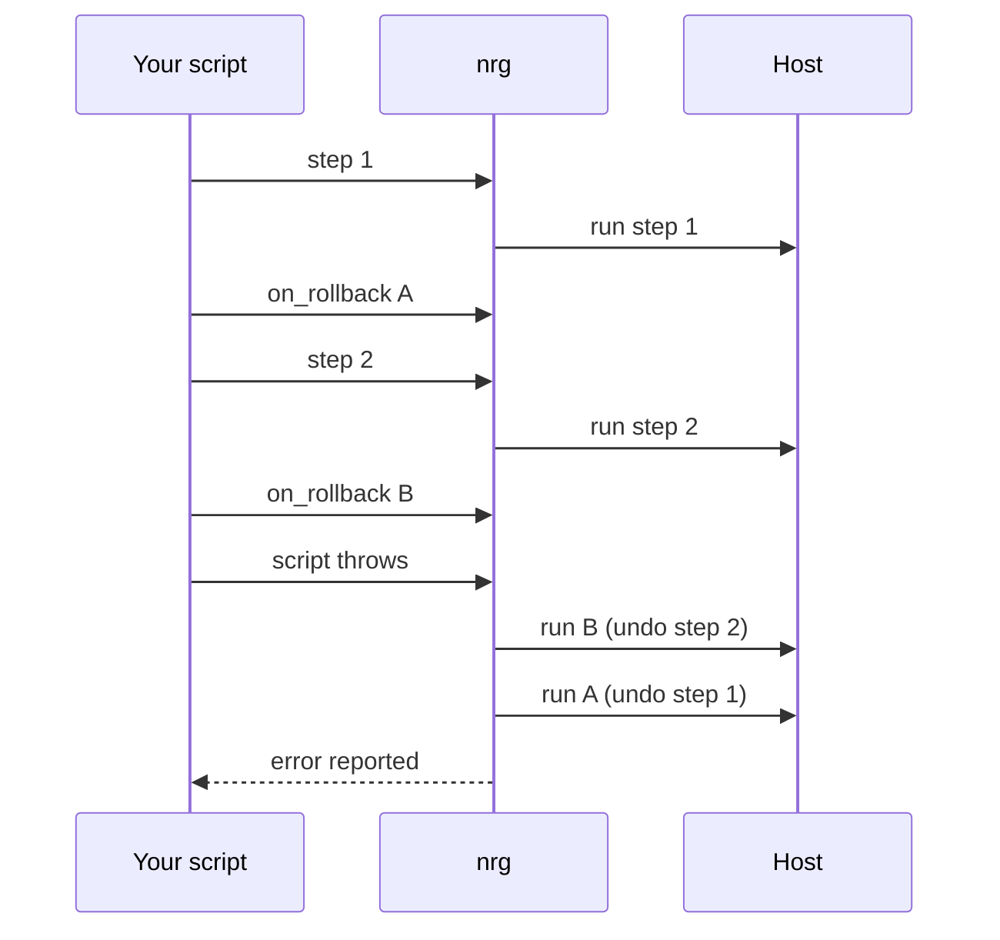

# Writing scripts

This page shows how to write your own `Energize.rhai` and run it with `nrg`.
{: .fs-6 .fw-300 }

A script is a [Rhai](https://rhai.rs) file. Each function you define becomes a task you can run from the command line.

## Tasks are functions

Here is a whole `Energize.rhai`. It has two tasks.

```rhai
const HOSTS = ["web1", "web2"];

fn status() {
    for r in ssh_exec_all(global::HOSTS, "uptime") {
        print(r.stdout);
    }
}

fn restart(service) {
    for host in global::HOSTS {
        ssh_exec(host, `systemctl restart ${service}`);
    }
}
```

List the tasks and run one:

```console
$ nrg tasks
Functions:
  restart (1 arg)
  status

$ nrg run restart shop
```

`nrg run restart shop` calls `restart("shop")`. On each host, nrg runs `systemctl restart shop` over SSH.

- **Arguments are strings.** A task like `fn num(n) { print(parse_int(n) + 1); }` run as `nrg run num 4` receives the string `"4"`. Convert it with `parse_int(n)` when you need a number.
- **An argument that starts with `-` goes after `--`.** Otherwise nrg reads it as its own flag: `nrg run num -- -5`.
- **nrg finds the file for you.** It looks for `Energize.rhai`, then `energize.rhai`, first in the project root and then in the current directory. The project root is the nearest parent directory that has a `.energize/` folder (created by your first real run), an `energize.toml` file or a `.nrg-key` file, so `nrg` also works from a subdirectory once one of those exists. Use `nrg run --file path.rhai <task>` to name another file.
- **`nrg exec` runs the top level of a file.** Use it for a one-off script that has no tasks: `nrg exec cleanup.rhai`.

`nrg run` runs the top level of the file first (the `const` lines and imports that sit outside any function), then your task. If the task name does not exist, nrg stops before the top level runs anything.

`nrg tasks` only reads the file. It does not run it and does not resolve imports.

## Hosts and constants

Define your hosts once, in a `const` at the top level. Read the constant inside a function as `global::HOSTS`.

```rhai
const HOSTS = ["web1", "web2"];

fn hosts() {
    for host in global::HOSTS {
        print(host);
    }
}
```

A host is anything `ssh` accepts: an alias from `~/.ssh/config`, or `user@hostname`.

Leave out the `global::` prefix and the function cannot see the constant. This is the error you get:

```rhai
fn hosts_bad() {
    for host in HOSTS {
        print(host);
    }
}
```

```console
$ nrg run hosts_bad
Error: Variable not found: HOSTS (line 10, position 17)
in call to function 'hosts_bad' (line 32, position 1)
```

The line numbers depend on where the function sits in your file.

If you see `Variable not found`, check for a missing `global::` first.

## Running commands

Three functions run shell commands:

| Function | Runs the command | Returns |
|---|---|---|
| `ssh_exec(host, cmd)` | on one host | one `ExecResult` |
| `ssh_exec_all(hosts, cmd)` | on every host in the array | an array of `ExecResult` |
| `local_exec(cmd)` | on your own machine | one `ExecResult` |

An `ExecResult` has these fields:

| Field | Type | Meaning |
|---|---|---|
| `ok` | bool | `true` when the exit code is 0 |
| `exit_code` | int | the command's exit code |
| `stdout` | string | what the command printed |
| `stderr` | string | what the command printed to stderr |
| `host` | string | the host the command ran on |

This task checks the disk on each host and stops when a check fails:

```rhai
const HOSTS = ["web1", "web2"];

fn disk() {
    for host in global::HOSTS {
        let r = ssh_exec(host, "df --output=pcent /");
        if !r.ok {
            throw `${host}: df failed with exit code ${r.exit_code}`;
        }
        let out = r.stdout;
        out.trim();
        print(`${host}: ${out}`);
    }
}
```

`ssh_exec` does not throw when the command fails. It hands you the result. If you never look at `r.ok`, a failed command goes unnoticed and `nrg` still exits with code 0.

Check `r.ok` and `throw` when the command matters. Or use [named steps](#named-steps), which throw for you.

## Named steps

`ssh_step` and `local_step` run a command and give it a name. They throw if the command fails, so you do not need to check `ok`. The name shows up in the plan and in the audit log.

```rhai
fn steps() {
    ssh_step("web1", "Restart shop", "systemctl restart shop", #{ env: #{ MODE: "fast" } });
    local_step("Say done", "echo done");
}
```

The last argument is an optional options map. `env` sets environment variables for the command. The other keys are `cwd`, `stdin`, `timeout_secs`, `stream`, `retries`, `retry_delay_ms` and `idempotent`; see [Builtins](builtins.md). `retries` needs `idempotent: true`, or the call throws.

Add `--dry-run` to see the plan without running anything:

```console
$ nrg run steps --dry-run

PLAN (dry run — no changes made):
  ssh     web1                   Restart shop: systemctl restart shop (cwd=inherited, timeout=None, retries=0; env/stdin omitted) [planned; execution-unverified]
  local   -                      Say done: echo done (cwd=inherited, timeout=None, retries=0; env/stdin omitted) [planned; execution-unverified]
2 action(s), 1 host(s). 0 executed.
Reads ran against the hosts' current state (an unreachable host is assumed absent); mutations returned synthetic success, nothing carries across steps, and waits are assumed to pass.
```

In a dry run, `ssh_exec`, `ssh_exec_all`, `local_exec`, `ssh_step` and `local_step` do not run. Each one is only recorded in the plan and returns success with empty output. This is true even for a read-only command such as `df`. Use `ssh_probe` for a read that should run during a dry run. See [Dry run](dry-run.md).

## Using the standard library

The standard library is a set of ready-made modules built into `nrg`. Import one with `import "std/<name>" as alias;`, then call its functions as `alias::function(...)`.

```rhai
import "std/deploy" as deploy;

const HOSTS = ["web1", "web2"];

fn ship(version) {
    deploy::deploy(global::HOSTS, "ghcr.io/acme/shop:" + version, "shop");
}
```

Two rules:

- **Put every `import` at the top of the file**, outside any function.
- **Import in every file that uses a module.** A module does not pass its imports on to your file. Import what your own file calls.

Any other path, such as `import "tools/helpers" as helpers;`, loads a `.rhai` file relative to your script.

The full list of modules and functions is in [Standard library](stdlib.md). To roll out containers, read [Deploying containers](deploy.md).

## Config maps

Rhai has no named arguments. Library functions that take options use one map as the last argument. A map looks like `#{ key: value }`.

```rhai
import "std/deploy" as deploy;

const HOSTS = ["web1", "web2"];

fn ship() {
    deploy::deploy(global::HOSTS, "ghcr.io/acme/shop:v1", "shop", #{
        container_port: 3000,
        health_path: "/up",
    });
}
```

Leave the map out to get the defaults. Check whether a key is set with `contains`:

```rhai
fn demo() {
    let cfg = #{ port: 8080 };
    print(cfg.contains("port"));  // true
    print(cfg.contains("host"));  // false
}
```

Reading a key that is not in the map gives `()`, the empty value. It is not an error.

## Remembering values: state

nrg can remember small values between runs. It keeps them in `.energize/state.json`, in the project root.

```rhai
fn remember() {
    state_set("last_version", "v1");
    print(state_get("last_version"));       // v1
    print(has_state("never_set"));          // false
}
```

| Function | What it does |
|---|---|
| `state_set(key, value)` | stores a string |
| `state_get(key)` | returns the value |
| `has_state(key)` | `true` if the key exists |
| `state_del(key)` | removes the key |

An absent key is `()`, not an empty string. Test with `has_state(key)` before you rely on a value.

`session_set`, `session_get` and `has_session` work the same way, but the values live only for the current run. Nothing is written to disk.

Do not store secrets in state. See [Secrets](secrets.md).

## Errors, transactions and rollback

Any `throw` stops the run. nrg prints the error and exits with code 1.

```rhai
throw "health check failed";
```

To undo earlier work when a later step fails, wrap the steps in `transaction(|| { ... })`. Right after each change, call `on_rollback(|| { ... })` with the code that undoes it.

```rhai
fn ship(version) {
    transaction(|| {
        ssh_step("web1", "Write version", `echo ${version} > /srv/shop/VERSION`);
        on_rollback(|| { ssh_exec("web1", "echo undo-A"); });

        ssh_step("web2", "Write version", `echo ${version} > /srv/shop/VERSION`);
        on_rollback(|| { ssh_exec("web2", "echo undo-B"); });

        throw "health check failed";
    });
}
```



When the script throws, nrg runs the undo code in reverse order: B, then A. Then it reports the error. The run above ends like this:

```console
$ nrg run ship v1
...
Error: Runtime error: health check failed (line 9, position 9)
in closure call (line 2, position 5)
in call to function 'ship' (line 13, position 1)
$ echo $?
1
```

Rules to know:

- **Register the undo right after the change it undoes.** An undo you register later never runs if the script fails in between.
- **Ctrl-C does the same unwind.** Ctrl-C stops the command that is running, then runs your registered undo code. A second Ctrl-C stops the undo that is running.
- **A dry run records undo steps but never runs them.** The plan lists each one as `register compensation`.
- **`deploy()` refuses to run inside your own transaction.** It has its own rollback. Call it at the top level of a task instead.

Undo code that itself fails can leave a half-finished state. So can a change that has no undo registered. Keep undo code small and safe to run twice. More on this in [Safety and limits](safety.md).

## Staging and production (--dest)

Use `--dest` to run the same script against two environments.

```console
$ nrg --dest staging run ship v1
$ nrg --dest production run ship v1
```

`--dest` gives each name its own:

- **state keys.** Both live in one `state.json`, but staging never reads production's keys.
- **secrets file.** nrg checks the `NRG_SECRET_<NAME>` environment variable first, then `.energize/secrets.staging`, then the shared `.energize/secrets`. See [Secrets](secrets.md).

`--dest` does **not** separate container names. On a host shared by both, the staging and production containers for one service have the same name and replace each other. Give each destination its own hosts. The audit log is one list for the whole project; each entry records which destination it used.

Inside the script, `nrg_dest()` returns the name (`"default"` when you pass no `--dest`):

```rhai
fn hosts_for_dest() {
    if nrg_dest() == "production" {
        ["web1", "web2"]
    } else {
        ["staging1"]
    }
}
```

A name may use letters, digits, `-` and `_`.

## Rhai traps

| Trap | What happens | Do this |
|---|---|---|
| `s.trim()` | It changes `s` in place and returns nothing useful | Write `s.trim();` on its own line, then use `s` |
| `state_get("missing")` | Returns `()`, not `""` | Check `has_state("missing")` first |
| `"a" + secret("X")` | Throws, so a secret cannot leak into a string | Use `sh_quote(secret)` for a shell argument, or `reveal(secret)` when you mean it |
| `HOSTS` inside a function | `Variable not found` | Write `global::HOSTS` |
| `fn go()` | `go` is a reserved word in Rhai | Pick another task name |

## Next

- [Deploying containers](deploy.md): roll out an image to your hosts with no downtime.
- [Dry run](dry-run.md): see what a run would do before it does it.
- [Builtins](builtins.md): every function that is always available.
