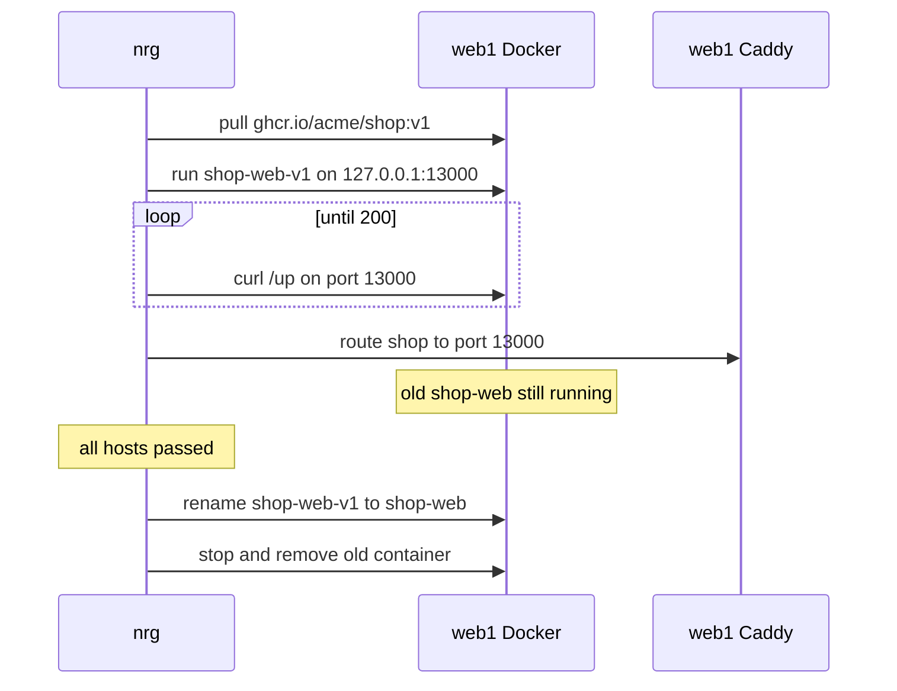
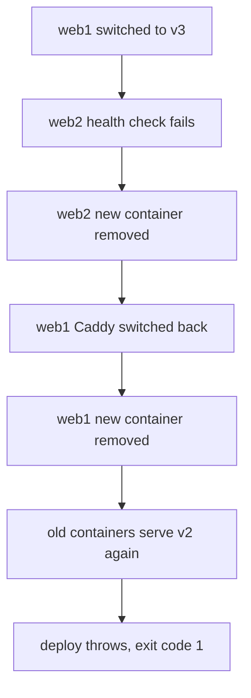

# Deploying containers

Ship a Docker image to one or more hosts with no downtime, and roll it back if you need to.

Each host runs two things for you: Docker, which runs your container, and [Caddy](https://caddyserver.com), a reverse proxy. Caddy gets HTTPS certificates for your domain and sends visitors to whichever container is healthy. `nrg` sets Caddy up for you.

## The whole thing in one script

Save this as `Energize.rhai`. It builds `ghcr.io/acme/shop:<tag>`, pushes it, and rolls it out to `web1` and `web2`.

```rhai
import "std/deploy" as deploy;

const HOSTS = ["web1", "web2"];

fn ship(tag) {
    deploy::deploy(global::HOSTS, "ghcr.io/acme/shop:" + tag, "shop", #{
        container_port: 3000,
        health_path: "/up",
        domain: "shop.example.com",
    });
}

fn rollback() {
    deploy::rollback(global::HOSTS, "shop");
}
```

Your app needs a `Dockerfile`, must listen on `container_port` (default 3000), and must answer `200` on `health_path` (default `/up`).

Look at the plan first. A dry run changes nothing:

```console
$ nrg run ship v1 --dry-run
```

The output is a log of the steps, then a `PLAN` with one line per action (lock, build, push, pull, Caddy, start, switch, clean up). [Dry run](dry-run.md) shows it in full.

A dry run still reads from your hosts. It runs no builds, pulls or container starts, and it assumes health checks pass. See [Dry run](dry-run.md).

When the plan looks right, run it for real:

```console
$ nrg run ship v1
```

It prints the same steps, with real container names and ports.

## Before the first deploy

Each host needs Docker and the Caddy proxy. `nrg setup` installs Docker (with `--yes`) and starts Caddy. Look first:

```console
$ nrg setup --host web1 --host web2 --dry-run
Would install Docker (https://get.docker.com) on: web1, web2

PLAN (dry run — no changes made):
  ssh     web1                   docker pull 'caddy:2' [planned; execution-unverified]
  ssh     web1                   docker rm -f caddy 2>/dev/null || true [planned; execution-unverified]
  write   web1                   write 106 bytes -> /etc/caddy/caddy.json [planned; execution-unverified]
  ssh     web1                   docker run -d --name caddy --restart unless-stopped --network host ... [planned; execution-unverified]
  ...
14 action(s), 2 host(s). 0 executed.
Reads ran against the hosts' current state (an unreachable host is assumed absent); mutations returned synthetic success, nothing carries across steps, and waits are assumed to pass.
```

Then do it:

```console
$ nrg setup --host web1 --host web2 --yes
web1: Docker installed
web2: Docker installed
...
```

A host that already has Docker prints `<host>: container runtime already present (docker)` instead.

`--yes` lets `nrg setup` install Docker with the get.docker.com script, as root. Without it, if any host has no container runtime, `nrg setup` lists those hosts and stops. It does nothing on any host, not even the ones that already have Docker, and it still exits 0.

If you also want a Docker network, add `--network shopnet` and pass the same name as `network` to `deploy()`. A default deploy does not need one.

If you skip `nrg setup` and Docker is already there, `deploy()` still boots Caddy on any host where it is not running.

## What happens during a deploy

`deploy()` does the slow, safe work first. It switches traffic only after the new container passes its health check, and it keeps the old container until every host has switched.

1. Take the deploy lock on every host.
2. Build the image on your machine (skip with `skip_build`).
3. Push it to the registry (skip with `skip_push`).
4. Pull it on all hosts at once.
5. Run your `pre_deploy` command, if you set one. See [Database migrations](#database-migrations). If a later step fails, `pre_deploy_undo` runs after the unwinding below, when every host was restored.
6. Make sure Caddy is running on every host.
7. Then, one host at a time:
   - Start the new container on a free port on `127.0.0.1`.
   - Poll `health_path` until it answers `200`.
   - Switch Caddy to the new container.
   - Leave the old container running.
8. When every host has passed, save the new version in `.energize/state.json`. Then, on each host, rename the new container to `shop-web`, stop and remove the old one, and release the lock.

Here is one host:



Hosts are rolled one at a time, in the order you list them. During the roll, hosts that have switched serve the new version and the rest still serve the old one.

## When something fails

Suppose `web1` switches fine and `web2` never becomes healthy. This is a real run against a fake `web2` that always answers `503`. It takes about a minute, because `nrg` tries 30 times (`health_attempts`) before it gives up:

```console
$ nrg run ship v3
...
  [web1]
    starting shop-web-v3-13000 on port 13000
    waiting for health...
  health check passed on web1 (1/30, 1/1 consecutive)
    switching traffic -> localhost:13000

  [web2]
    starting shop-web-v3-13000 on port 13000
    waiting for health...
Error: Runtime error: Health check failed on web2 after 30 attempts: http://localhost:13000/up (last status: 503, needed 1 consecutive pass(es)) @ 'std/deploy' (line 794, position 9)
in call to function 'deploy' (from 'std/deploy') (line 6, position 13)
...
$ echo $?
1
```

`nrg` undoes what it did:



Until the whole fleet passes, the old containers keep running. If a later host fails, every switched host is pointed back at its old container. `deploy()` throws, so `nrg run` exits non-zero. Your script can `try`/`catch` the error if it wants to do more.

The unwinding does not touch your database. If you ran a `pre_deploy` migration, it stays applied unless you set `pre_deploy_undo` (which runs only if every host was restored). See [Database migrations](#database-migrations).

What `nrg` cannot undo: if your network drops, or `nrg` is killed, in the middle of a switch, it cannot know which version Caddy points at. In that case it keeps the new container and leaves a transition journal (`shop.transition.<host>` in state) for you to check. The next deploy to that host refuses to start (`Unreconciled deployment transition for shop on web1; verify remote routing and containers before clearing this journal.`) until you have checked and cleared it. To clear it, call `state_del("shop.transition.web1")` in a script, or run `nrg remove`. See [Known limits](safety.md#known-limits).

## Options

Put these in the map you pass as the fourth argument to `deploy()`. Every key is optional.

| Key | Default | What it does |
| --- | --- | --- |
| `container_port` | `3000` | Port your app listens on inside the container. |
| `envs` | `#{}` | Environment variables for the container. |
| `volumes` | `#{}` | Mounts as `#{ "/host/path": "/container/path" }`. |
| `network` | none (no Docker network) | Docker network to attach the container to. |
| `publish_all_interfaces` | `false` | Publish the port on every interface instead of loopback only. |
| `health_path` | `"/up"` | URL path that must return `200`. |
| `health_attempts` | `30` | How many times to try before failing the deploy. |
| `health_interval` | `2` | Seconds between tries. |
| `health_timeout` | `30` | Seconds to wait for each request. |
| `health_consecutive` | `1` | Passes in a row required. Raise it for apps that flap while booting. |
| `domain` | none | Your domain. Caddy gets a certificate for it automatically. |
| `proxy_version` | `"2"` | Caddy image tag, used when `nrg` starts Caddy. It does not replace a Caddy that is already running. |
| `keep_images` | unset | Keep only the newest N other tags of the image on each host. The current and previous tags are always kept. |
| `pre_deploy` | none | Command run once in the new image before traffic moves. See [Database migrations](#database-migrations). |
| `pre_deploy_version` | none | Command that prints the database schema version, such as `bin/rails db:version`. `nrg` reads it before and after `pre_deploy`. Needs `pre_deploy`. See [Database migrations](#database-migrations). |
| `pre_deploy_undo` | none | Command run once in the new image to undo `pre_deploy` if a later step fails and every host went back to its old containers. With `pre_deploy_version`, it runs only if the version changed, and `{before}` is the version before. Needs `pre_deploy`. `nrg rollback --undo-pre-deploy` can also run it later. See [Database migrations](#database-migrations). |
| `pre_deploy_cmd` | none | Raw shell command run over SSH on each host before its new container starts. |
| `post_deploy_cmd` | none | Raw shell command run on each host after the deploy is committed. A failure prints a warning and does not fail the deploy. |
| `build_host` | local machine | Build (and push) on this host over SSH. |
| `build_args` | `#{}` | Build arguments, as `#{ "KEY": "value" }`. |
| `dockerfile` | `"Dockerfile"` | Dockerfile path. |
| `build_context` | `"."` | Build context directory. |
| `platform` | none | Target platform, or a comma-separated list for a multi-arch image. |
| `skip_build` | `false` | Do not build. Use an image that already exists. |
| `skip_push` | `false` | Do not push. A build with a comma-separated `platform` pushes as it builds, so that combination is refused. |
| `skip_lock` | `false` | Do not take the deploy lock. See [Safety and limits](safety.md). |

The version is the image tag: `ghcr.io/acme/shop:v1` is version `v1`. An image with no tag is version `latest`.

`proxy` is not an option you need. If you set it, the only accepted value is `"caddy"`.

`pre_deploy`, `pre_deploy_version`, `pre_deploy_undo`, `pre_deploy_cmd` and `post_deploy_cmd` are run exactly as you write them. Never build them from input you do not trust.

By default the container's port is published on `127.0.0.1` only, so people reach your app through Caddy and not directly.

## Database migrations

Use `pre_deploy`. It runs your command once, in a throwaway container made from the new image, before any host switches traffic:

```rhai
import "std/deploy" as deploy;

const HOSTS = ["web1", "web2"];

fn ship(tag) {
    deploy::deploy(global::HOSTS, "ghcr.io/acme/shop:" + tag, "shop", #{
        pre_deploy: "bin/rails db:migrate",
    });
}
```

The dry run shows it:

```console
$ nrg run ship v9 --dry-run
...
--- Pre-deploy (new-image release task) on web1 ---
    bin/rails db:migrate
...
  ssh     web1                   docker run --rm 'ghcr.io/acme/shop:v9' bin/rails db:migrate [planned; execution-unverified]
```

It runs on the first host in your list. If the command exits non-zero, the deploy stops before any new container starts or any traffic moves. The image is already built, pushed and pulled by then, and the migration may have changed your database before it failed. The container gets the same `envs` as your app.

Write migrations so the old version can still run against the new schema. Old containers keep serving while the migration runs.

### If a later step fails

Say the migration succeeds and then a host never becomes healthy. `nrg` puts the old containers back, as described in [When something fails](#when-something-fails). It does not undo the migration. Your database keeps the new schema while the old version serves traffic.

To undo it, set `pre_deploy_undo`. Also set `pre_deploy_version`, so `nrg` knows whether the migration changed anything and can go back to exactly the version before:

```rhai
deploy::deploy(global::HOSTS, "ghcr.io/acme/shop:" + tag, "shop", #{
    pre_deploy: "bin/rails db:migrate",
    pre_deploy_version: "bin/rails db:version",
    pre_deploy_undo: "bin/rails db:migrate VERSION={before}",
});
```

`nrg` runs `pre_deploy_version` twice, on the first host in a throwaway container from the new image, with the same `envs` and `network` as `pre_deploy`: once just before `pre_deploy` and once just after it. Only the command's standard output is read. The version is the last word of the last non-empty line, so `Current version: 20261101120000` gives `20261101120000`. It must start with a letter or digit, contain at least one digit, and only use letters, digits and `. _ : + -` (1 to 128 characters). Anything else fails the deploy, because the version is put into a shell command. If the first read fails, the deploy stops before the migration runs. That includes a database that does not exist yet: create it first, or add `pre_deploy_version` after the first deploy.

- `nrg` compares what the command prints before and after. If it is the same, `nrg` says so and there is nothing to undo.
- If it changed, `nrg` prints `version <before> -> <after>`. `{before}` in `pre_deploy_undo` becomes the version from before, so the undo goes back to exactly that version, however many migrations ran.
- If the migration ran but the version after it cannot be read, the deploy fails, the undo does not run, and `nrg` prints the version before and the command to run by hand.

The probe must change whenever a migration is applied, or the undo is not reliable. With Rails, `db:version` prints the highest applied version, so a release that only adds an older, out-of-order migration looks unchanged and is not undone, and `VERSION={before}` would not revert such a migration anyway. If the version before is `0` (the first migration on an empty database), `db:migrate VERSION=0` reverses every migration and drops the tables. That is the correct inverse, but destructive. An app with several databases prints one version per database, and `nrg` reads the last line only, so use a command that prints just the one version your undo goes back to.

If you deploy the same image again (a canary host first, then the rest) and each call changes the version, the saved undo goes back to the version before the first call, as long as each call starts where the last one ended. If the database moved in between, the later call is saved on its own.

`pre_deploy_version` needs `pre_deploy`, and `{before}` needs `pre_deploy_version`. Both mistakes are errors raised before any host is touched. `pre_deploy_version` without `pre_deploy_undo` is fine; it just prints the versions.

`pre_deploy_undo` runs once, on the first host, in a throwaway container from the new image (the one that has the migration files). It gets the same `envs` and `network` as `pre_deploy`. It runs last, and only if every host was put back on its old containers. If a host could not be restored (for example Caddy there could not be pointed back, or its new container could not be removed), the new containers may still be serving there and need the new schema. In that case `nrg` leaves the migration in place and prints a warning naming the hosts and the command to run by hand once they are sorted out.

When it runs and when it does not:

- It runs when a step after the migration fails, before the deploy is committed. That includes Caddy failing to start and any host failing its health check. It also runs if you press Ctrl-C after the migration has finished. If you interrupt while the migration is still running, `nrg` does not run the undo, because it cannot know whether the migration applied. It prints a warning with the command to run by hand if it did.
- It does not run if a host could not be restored, as described above. The deploy still fails with the original error.
- It does not run if `pre_deploy` itself failed. A half-finished migration is for your migration tool to clean up.
- It does not run when the deploy succeeds.
- It does not run in a rollback unless you ask. By default `nrg rollback` does not run `pre_deploy` or `pre_deploy_undo`. To undo the migration of the release you roll back, use `--undo-pre-deploy`; see [Rolling back](#rolling-back). If a script passes `pre_deploy` to `deploy::rollback()`, that command runs, with no undo; a `pre_deploy_undo` passed there is ignored with a note.
- If the undo command fails, the deploy still fails with the original error. `nrg` prints the undo command and its error, and says the database may still have the new schema. That message is printed above the final `Error:` line. Fix it by hand.
- Setting `pre_deploy_undo` without `pre_deploy` is an error, raised before any host is touched.

A dry run prints the command under the `pre_deploy` line, so you can see what would run. It also plans the two version reads, and leaves `{before}` as it is, because the version is not known yet.

Without `pre_deploy_version`, the undo runs whenever `pre_deploy` ran, even if it changed nothing. A bare `bin/rails db:rollback` would then revert a migration from an older release. Set `pre_deploy_version` whenever your undo is not safe to run blindly.

Treat the undo as a safety net, not a plan. A down-migration can lose data, for example by dropping a column the new code was already writing to. Keep writing migrations the old version can run against.

## Secrets in the container

`envs` needs plain strings. Wrap a secret in `reveal()`:

```rhai
import "std/deploy" as deploy;

const HOSTS = ["web1", "web2"];

fn ship(tag) {
    deploy::deploy(global::HOSTS, "ghcr.io/acme/shop:" + tag, "shop", #{
        envs: #{
            "DATABASE_URL": reveal(secret("DATABASE_URL")),
            "RAILS_ENV": "production",
        },
    });
}
```

`secret("DATABASE_URL")` reads the value from the environment variable `NRG_SECRET_DATABASE_URL`, or from a file you made with `nrg secrets encrypt`. See [Secrets](secrets.md).

Passing `secret("DATABASE_URL")` without `reveal()` fails with `refusing to concatenate a Secret into a string`. The error comes late, after the build, push and pull.

`nrg` writes the variables to a temporary file on the host, permissions 0600, and starts the container with `--env-file`. They never appear in the command line or in the plan. Anyone with Docker access on the host can still read them with `docker inspect`.

`nrg` also saves your effective options in `.energize/state.json`, so a rollback can reuse them. That includes revealed secret values. Keep `.energize/state.json` (and its `.bak` copy) out of git, CI artifacts and backups. Only the encrypted secrets files are committed. See [what to commit](secrets.md#what-to-commit).

## Multi-arch builds

If your machine is not the same architecture as your servers (an Apple Silicon laptop and x86 servers), set `platform`:

```rhai
import "std/deploy" as deploy;

const HOSTS = ["web1", "web2"];

fn ship(tag) {
    deploy::deploy(global::HOSTS, "ghcr.io/acme/shop:" + tag, "shop", #{
        platform: "linux/amd64",
    });
}
```

For one image that runs on both, list both. Replace the `deploy::deploy(...)` call inside `ship()` with the call below. The build pushes the image as it builds, so you cannot combine this with `skip_push`:

```rhai
deploy::deploy(global::HOSTS, "ghcr.io/acme/shop:" + tag, "shop", #{
    platform: "linux/amd64,linux/arm64",
});
```

To build on a server instead of your laptop, set `build_host`. Again, this replaces the call inside `ship()`:

```rhai
deploy::deploy(global::HOSTS, "ghcr.io/acme/shop:" + tag, "shop", #{
    build_host: "build1",
});
```

If you set neither and your machine differs from the first host, a real deploy stops before building and tells you.

## Rolling back

`nrg` remembers the image that was running before the current one, as `shop.prev`. Plan the rollback:

```console
$ nrg rollback shop --dry-run
==> Rolling back shop to ghcr.io/acme/shop:v1
==> Deploying shop v1 to 2 host(s)
...
==> Deploy complete: shop v1
```

Run it without `--dry-run` to do it. It is a normal deploy of the older image, with the same health checks and the same unwinding on failure. It reuses the options that older image was deployed with. By default it does not run `pre_deploy` or `pre_deploy_undo`, so your database schema stays as it is. To undo the migration too, see [Undoing the migration](#undoing-the-migration).

To go to a specific image, name it:

```console
$ nrg rollback shop --image ghcr.io/acme/shop:v0
```

You can also call it from a script, as in the example at the top: `deploy::rollback(global::HOSTS, "shop")`.

The default target is only the one previous image. Older versions need `--image`.

Three things to know:

- After a rollback, the "previous" image is the one you just left. Running `nrg rollback shop` twice takes you back to the broken version.
- If the saved previous image is tagged `:latest`, rollback refuses it, and you have to name an image with `--image`. `deploy()` also warns when you deploy `:latest`. Use real version tags.
- `nrg rollback` acts on the hosts recorded in state. Add `--host web1` to roll back one host only.

### Undoing the migration

A rollback leaves the database alone. If the release you are leaving ran a migration and you want it undone, ask for it:

```console
$ nrg rollback shop --undo-pre-deploy
==> Rolling back shop to ghcr.io/acme/shop:v41
...
==> Deploy complete: shop v41

--- Undo pre-deploy of v42 (ghcr.io/acme/shop:v42) on web1 ---
    running the pre_deploy_undo saved with v42
    If this step is interrupted, the migration may be half-undone: check the database by hand.
```

In order, `nrg` first rolls the containers back to the previous image and waits for that to finish. Then it runs the undo once, on the first host, in a throwaway container from the image you are leaving (it has the migration files). The command, `envs` and `network` are the ones saved when that release was deployed, so only a release deployed with this version of `nrg` or later can be undone. `nrg` does not print the saved command here, because it can contain a secret. `--dry-run` shows the undo as the last step of the plan.

It refuses to start, before it changes anything on a host, in these cases:

- There is nothing to undo: the release you are leaving was deployed without `pre_deploy_undo`, by an older `nrg`, by a rollback, or its `pre_deploy` did not change the schema version (when you set `pre_deploy_version`). Run the rollback without the flag to roll back the containers only.
- The target is not the saved previous release. With `--image`, only the saved previous image is allowed. Undoing a migration under any other code is unsafe.
- You rolled back only some of the hosts the release was deployed to, counting every `deploy()` call of that image (a canary host first, then the rest). The other hosts would stay on the new code with the old schema, so roll back all of them or drop the flag. A canary on a new image, while the other hosts still run the previous one, can be rolled back alone: those hosts already run the code the old schema belongs to.
- The target is a release whose migration an earlier `--undo-pre-deploy` already undid. Its code would run on a database without its migration, so a plain `nrg rollback` refuses. Run `deploy()` for that version again so its `pre_deploy` runs. That also clears the refusal.
- The database has moved. If the release you are leaving was deployed with `pre_deploy_version`, `nrg` reads the version again before it touches any container (this one check runs a throwaway container on the first host, while holding the lock). If it is not the version that release left, or it cannot be read, the rollback is refused, naming both versions. Drop the flag to roll back the containers only.

Every one of these refusals comes before the `hook_pre_deploy` hook runs.

The undo command that runs is the one saved with that release, with `{before}` already filled in.

If the container rollback fails, the undo does not run. If the undo fails, the containers stay rolled back. `nrg` prints its error, says the database may still have the new schema, and exits non-zero with `Containers were rolled back to <image>, but the migration undo failed`. Undo the migration by hand. State says the previous image is current. If you press Ctrl-C while the undo is running, `nrg` cannot report that, so check the database by hand.

It is opt-in because a down-migration can lose data: anything written to the new columns or tables since the deploy is gone. In a script, use `deploy::rollback(hosts, "shop", #{ undo_pre_deploy: true })`. It makes the same checks.

## Databases and caches (accessories)

An accessory is a container that is not part of the rolling deploy, such as Postgres or Redis. It keeps running between deploys.

```rhai
import "std/deploy" as deploy;

fn db() {
    deploy::accessory_run("web1", "shop-db", "postgres:16", #{
        envs: #{ "POSTGRES_PASSWORD": reveal(secret("DB_PASSWORD")) },
        volumes: #{ "shop-db-data": "/var/lib/postgresql/data" },
    });
}
```

| Function | What it does |
| --- | --- |
| `accessory_run(host, name, image, cfg)` | Start it. Does nothing if a container with that name is running. |
| `accessory_upgrade(host, name, image, cfg)` | Pull the new image, replace the container, keep named volumes. Pass the same `cfg` as before. |
| `accessory_restart(host, name)` | Restart the same container. It cannot change the image. |
| `accessory_stop(host, name)` | Stop it and keep it and its volumes. |

`cfg` takes `ports`, `envs`, `volumes`, `network` and `cmd`.

Accessories have no health check and no rollback. `accessory_run` and `accessory_upgrade` wait one second and throw if the container has already exited. Back up your data before `accessory_upgrade`.

## After a deploy

| I want to... | Run |
| --- | --- |
| See what is deployed and whether it is running | `nrg status shop` |
| Fail in CI unless every host is running | `nrg status shop --check --json` |
| Follow logs from all hosts | `nrg logs shop -f` |
| Open a console in the live container | `nrg app exec shop --host web1 -i -- bin/rails console` |
| See what ran, when and who ran it | `nrg audit` |
| Stop and remove the app on one host | `nrg remove shop --host web1` |
| See who holds the deploy lock | `nrg lock status shop --host web1` |

`nrg remove` only prints a plan until you add `--yes`. It leaves Caddy and your accessories alone:

```console
$ nrg remove shop --host web1
Would remove "shop-web" from:
  web1
Re-run with --yes to actually remove it. This does not touch the shared proxy or any accessories on these hosts.
```

`nrg status` shows what is recorded:

```console
$ nrg status shop --offline
shop
  version:      v2
  image:      ghcr.io/acme/shop:v2
  deployed_at:      2026-11-10 17:31:55 UTC
  previous:      ghcr.io/acme/shop:v1
  hosts:
    web1                         target localhost:13000        [offline]
    web2                         target localhost:13000        [offline]
```

`previous` is the image `nrg rollback` goes back to. `--offline` reads only the saved state. Without it, `nrg status` also asks each host whether the container is running.

To show a maintenance page, call `proxy_maintenance` from `std/caddy`. With `true` it answers every request with a 503. With `false` it sends traffic back to the `target` you give it. Each deploy picks a new port, so read the target from state:

```rhai
import "std/caddy" as caddy;

const HOSTS = ["web1", "web2"];

fn maintenance(mode) {
    for host in global::HOSTS {
        caddy::proxy_maintenance(host, "shop", mode == "on", #{
            target: state_get("shop.target." + host),
            health_path: "/up",
        });
    }
}
```

Run `nrg run maintenance on`, and later `nrg run maintenance off`. Keep `health_path` so Caddy keeps checking your app after maintenance ends.

## Next

- [Secrets](secrets.md): keep passwords out of your scripts.
- [Dry run](dry-run.md): what a plan shows and what it cannot.
- [Standard library](stdlib.md): every function in `std/deploy` and `std/caddy`.
