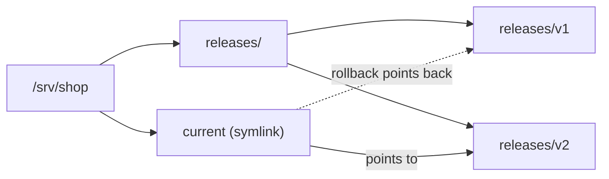
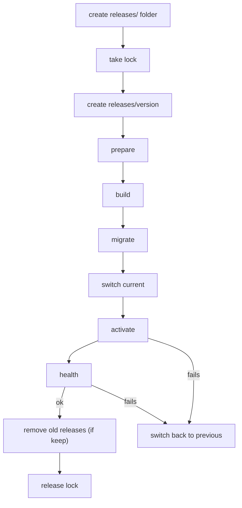

# Directory releases

Deploy a build directory, a binary or a tarball without containers, and roll back instantly.

## A first deploy

Create a script from the `release` template:

```sh
nrg init --template release
```

Edit the generated `Energize.rhai` so it points at your app. This version deploys `shop` to `/srv/shop` on `deploy@web1`:

```rhai
import "std/release" as release;

fn config() {
    #{
        prepare: "cp -R /srv/staged/shop/. .",
        activate: "sudo -n systemctl restart shop",
        health: "curl --fail --silent --show-error http://127.0.0.1:8080/health",
        deactivate: "sudo -n systemctl stop shop",
        timeout_secs: 120
    }
}
fn deploy(version) {
    release::deploy("deploy@web1", "/srv/shop", version, config());
}
fn rollback(version) {
    release::rollback("deploy@web1", "/srv/shop", version, config());
}
```

Look at the plan first:

```sh
nrg run deploy v1 --dry-run
```

```text
PLAN (dry run — no changes made):
  ssh     deploy@web1  Prepare release root: mkdir -p '/srv/shop/releases' ...
  lock    deploy@web1  mkdir /srv/shop/.nrg-release-lock (owned deploy lock) ...
  ssh     deploy@web1  Create immutable release directory: mkdir '/srv/shop/releases/v1' ...
  ssh     deploy@web1  Prepare release: cp -R /srv/staged/shop/. . ...
  rollback -           register compensation ...
  ssh     deploy@web1  Switch current release: ... ln -s ... mv -fT ...
  ssh     deploy@web1  Activate release: sudo -n systemctl restart shop ...
  ssh     deploy@web1  Check release: curl --fail --silent --show-error http://127.0.0.1:8080/health ...
  lock    deploy@web1  rmdir /srv/shop/.nrg-release-lock (owned deploy lock) ...
9 action(s), 1 host(s). 0 executed.
...
```

The `rollback - register compensation` line is where nrg records how to undo the switch if a later step fails. It is not a command that runs on the host.

In a dry run, `std/release` does not read anything from the host. It cannot see the current release, so it cannot tell whether `v1` already exists or whether `current` is a symlink. Run `nrg run deploy v1` without the flag to deploy for real.

## How it works

Every deploy creates a new directory, `releases/<version>`. nrg runs your `prepare` command inside it, then points the `current` symlink at it. Your service always runs from `/srv/shop/current`.



- A release directory is created once and never rebuilt. Deploying a version that already exists fails.
- `current` is replaced in one atomic step, so nothing ever sees a half-switched link.
- While a deploy or rollback runs, the lock directory `.nrg-release-lock` blocks a second one on the same host. If a crash leaves it behind, see [Safety and limits](safety.md#known-limits); `nrg lock` does not manage this lock.
- Versions may contain letters, digits, `.`, `_` and `-`. The root must be an absolute path without a trailing slash, such as `/srv/shop`.
- If `/srv/shop/current` exists but is not a symlink, nrg stops.

The steps run in this order:



`build` and `migrate` run only if you set them. On a first release there is no previous release to switch back to: nrg removes `current` and runs `deactivate` if you set it (see below).

## The hooks

Each hook is a shell command that runs on the host. Pass them as keys of the config map.

`prepare`, `build` and `migrate` run inside `releases/<version>`. `activate`, `health` and `deactivate` run in the root (`/srv/shop`), so use `NRG_RELEASE_DIR` or `/srv/shop/current` to reach the release.

| Key | Required | What it does |
|---|---|---|
| `prepare` | yes | Fills the new directory: copy files, unpack a tarball, download a binary. |
| `build` | no | Builds the app inside the new directory. |
| `migrate` | no | Runs database migrations. Set it yourself; nrg never guesses. |
| `activate` | yes | Starts or restarts your service after `current` is switched. |
| `health` | yes | Must exit 0 when the new release is healthy. |
| `deactivate` | no | Stops the service. Runs only if `activate` or `health` fails on the very first release. |
| `keep` | no | Whole number, at least 2. Number of release directories to keep after a successful deploy. |
| `env` | no | Map of environment variables for every hook. |
| `timeout_secs` | no | Seconds each hook may run. Default 600. |

Every hook can read these variables:

| Variable | Value |
|---|---|
| `NRG_RELEASE_DIR` | The release being deployed, such as `/srv/shop/releases/v2`. |
| `NRG_CURRENT_LINK` | `/srv/shop/current`. |
| `NRG_PREVIOUS_RELEASE` | The release `current` pointed to before, or empty on a first release. |

With `keep: 3`, nrg keeps the new release, the one it replaced and the newest others, up to that count. It deletes the rest.

## When a step fails

- If `prepare`, `build` or `migrate` fails, nothing live has changed. `current` still points at the old release, and the lock is released. The half-built directory stays, so use a new version name for the next try.
- If `activate` or `health` fails after the switch, nrg points `current` back at the previous release, runs `activate` again, then runs `health` to check it.
- If it was the first release, there is nothing to go back to. nrg removes `current` and runs `deactivate` if you set it.

When a deploy fails after the switch, `activate` runs again for the previous release, so make it safe to repeat. A restart command is.

## Rolling back

Name the release you want back:

```sh
nrg run rollback v1
```

This checks that `releases/v1` exists, switches `current`, then runs `activate` and `health`. It does not rebuild or migrate. nrg never guesses which release is safe, so you always give the version.

## Several hosts

Loop over a host list in your own function:

```rhai
import "std/release" as release;

const HOSTS = ["deploy@web1", "deploy@web2"];

fn config() {
    #{
        prepare: "cp -R /srv/staged/shop/. .",
        activate: "sudo -n systemctl restart shop",
        health: "curl --fail --silent --show-error http://127.0.0.1:8080/health"
    }
}
fn deploy(version) {
    for host in global::HOSTS {
        release::deploy(host, "/srv/shop", version, config());
    }
}
fn rollback(version) {
    for host in global::HOSTS {
        release::rollback(host, "/srv/shop", version, config());
    }
}
```

Hosts deploy one after another. If web2 fails, web2 goes back to its previous release, but web1 stays on the new one. There is no all-or-nothing switch across hosts. If you need web1 back too, run `nrg run rollback <previous>`. It switches every host in the list.

## Framework defaults

`std/release_recipes` has `rails`, `django`, `nextjs`, `phoenix` and `laravel`. Each takes your config and fills in a `build` command and, except for `django`, an environment variable. Your own keys win.

| Recipe | Environment variable |
|---|---|
| `rails` | `RAILS_ENV=production` |
| `nextjs` | `NODE_ENV=production` |
| `phoenix` | `MIX_ENV=prod` |
| `laravel` | `APP_ENV=production` |
| `django` | none |

```rhai
import "std/release" as release;
import "std/release_recipes" as recipes;

const HOSTS = ["deploy@web1", "deploy@web2"];

fn config() {
    recipes::rails(#{
        prepare: "cp -R /srv/staged/shop/. .",
        activate: "sudo -n systemctl restart shop",
        health: "curl --fail --silent http://127.0.0.1:3000/up",
        keep: 3
    })
}
fn deploy(version) {
    for host in global::HOSTS {
        release::deploy(host, "/srv/shop", version, config());
    }
}
fn rollback(version) {
    for host in global::HOSTS {
        release::rollback(host, "/srv/shop", version, config());
    }
}
```

The dry run shows the added step `Release build: bundle install && bundle exec rails assets:precompile`. The recipe also sets `RAILS_ENV=production` for every hook, but the plan does not print environment variables.

The recipes do not install Ruby, Node or a database, and do not write your service files. You still provide `prepare`, `activate` and `health`. See the [Standard library](stdlib.md) for what each recipe adds.

## Next

- [Recipes](examples.md)
- [Testing a deploy](rehearsal.md)
