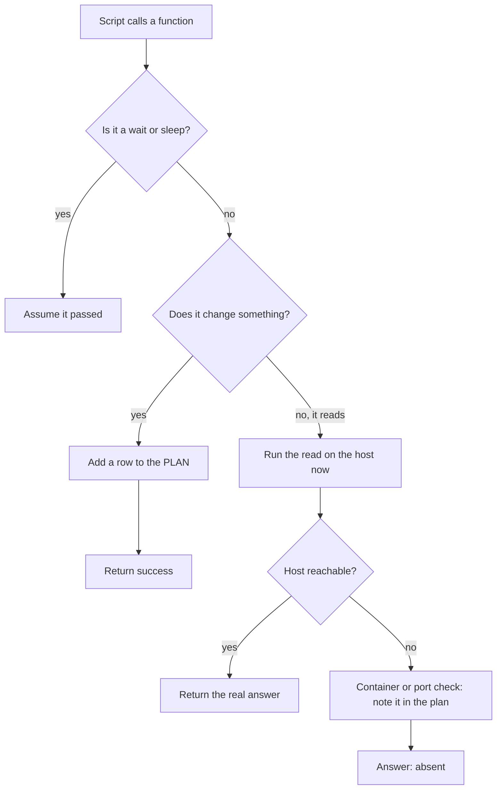

# Dry run

`--dry-run` shows you every change a script would make, and makes none of them. This page explains what it runs, what it only plans, and how to read the plan.

## Example

This is the `Energize.rhai` from [Getting started](getting-started.md). It deploys `shop` to two hosts.

```rhai
import "std/deploy" as deploy;

const HOSTS = ["web1", "web2"];

fn ship(tag) {
    deploy::deploy(global::HOSTS, "ghcr.io/acme/shop:" + tag, "shop", #{
        container_port: 3000,
        health_path: "/up",
        domain: "shop.example.com",
    });
}
```

Add `--dry-run` to see the plan:

```console
$ nrg run ship v1 --dry-run
==> Deploying shop v1 to 2 host(s)
...
  [web1]
    starting shop-web-v1-<auto> on port <auto>
    waiting for health...
  health check passed on web1 (1/30, 1/1 consecutive)
...
==> Deploy complete: shop v1

PLAN (dry run — no changes made):
  lock    web1                   mkdir /tmp/nrg-deploy-lock-shop (owned deploy lock) [planned; execution-unverified]
  lock    web2                   mkdir /tmp/nrg-deploy-lock-shop (owned deploy lock) [planned; execution-unverified]
  local   -                      docker build -t 'ghcr.io/acme/shop:v1' -f 'Dockerfile'  '.' [planned; execution-unverified]
  local   -                      docker push 'ghcr.io/acme/shop:v1' [planned; execution-unverified]
  ssh-all web1                   docker pull 'ghcr.io/acme/shop:v1' [planned; execution-unverified]
  ssh-all web2                   docker pull 'ghcr.io/acme/shop:v1' [planned; execution-unverified]
  ...
  ssh     web1                   docker run -d --restart unless-stopped --name 'shop-web-v1-<auto>' -p '127.0.0.1:<auto>:3000' 'ghcr.io/acme/shop:v1' [planned; execution-unverified]
  ...
  ssh     web1                   docker rename 'shop-web-v1-<auto>' 'shop-web' [planned; execution-unverified]
  ...
55 action(s), 2 host(s). 0 executed.
Reads ran against the hosts' current state (an unreachable host is assumed absent); mutations returned synthetic success, nothing carries across steps, and waits are assumed to pass.
```

Look at `health check passed on web1`. Nothing was probed. A dry run assumes the check passes, and the deploy still prints that line.

The command exits 0. Nothing was built, pushed, started or switched.

It did talk to your hosts. The script checks whether `caddy` and `shop-web` already run, and those checks are real SSH calls. Here is the SSH log from the run above (options trimmed):

```text
ssh -- web1 docker inspect -f ... 'caddy'
ssh -- web2 docker inspect -f ... 'caddy'
ssh -- web1 docker inspect -f ... 'shop-web'
ssh -- web2 docker inspect -f ... 'shop-web'
```

Four reads, no changes.

## The rules

1. **Changes are listed, not run.** Every command that would change something adds a row to the plan and returns success with empty output.
2. **Reads run for real.** Looking at a container, a port or a URL happens against the hosts as they are right now. A dry run can connect to your hosts and fetch your URLs.
3. **A read after a planned change still sees the old state.** If the plan would start a new container, a later "is it running?" check still answers as the host is now: `false`. Only `nrg`'s own state (`state_set`, `state_get`) remembers planned writes, and only in memory. The footer's "nothing carries across steps" is about host commands, not this state.
4. **An unreachable host does not stop the plan.** A container or port check that cannot run adds a row like `[probe failed — assuming shop-web absent]`, answers "absent", and the plan goes on. Other reads return their real failure result (`ssh_probe` gives exit code 255). A live run throws on the same failure.
5. **Waits are assumed to pass.** Some waits print `[dry-run] assuming ...`. The deploy health check prints `health check passed ...` even though nothing was probed. Either way the wait returns success. `sleep` does nothing.
6. **Values only a change could produce are placeholders.** A new container's host port shows as `<auto>`. Output of a local command is empty.
7. **Exit 0 is not a promise.** It means the script ran to the end under these assumptions. A live run can still fail.

## How a call is handled



## Which builtins run and which are planned

| Runs for real | Only planned |
|---|---|
| `ssh_probe`, `read_file` | `ssh_exec`, `ssh_exec_all`, `ssh_exec_stdin` |
| `http_get` | `local_exec`, `local_exec_stdin` |
| `container_running`, `container_healthy`, `container_image_id`, `port_open`, `pick_port` | `write_remote`, `upload_file`, `download_file` |
| | `local_step`, `ssh_step` |
| Preflight checks that only read (temporary-write checks are skipped and noted) | `http_post`, `http_put`, `http_patch`, `http_patch_all`, `http_delete` |
| | `state_set`, `state_update`, `state_del` |
| | `on_rollback` (recorded, never called) |
| | Remote locks |

Stdlib waits such as `wait_healthy` (in `std/healthcheck`) skip their probes and assume success. The `sleep` builtin returns at once.

Every builtin decides this for itself. `nrg` does not read your shell command to guess whether it changes anything. `ssh_exec("web1", "ls")` is planned even though `ls` is harmless. Use `ssh_probe` when you want a read. See [Builtins](builtins.md) for each one.

## Reading the plan

Each row has three columns: kind, host and detail.

| Kind | What it is |
|---|---|
| `local` | A command that would run on your machine |
| `local-stdin` | The same, with input piped in |
| `ssh` | A command on one host |
| `ssh-all` | A command fanned out to many hosts, one row per host |
| `ssh-stdin` | A command on one host with input piped in |
| `write` | A file that would be written on a host |
| `state` | A change to `nrg`'s saved state |
| `check` | An HTTP request (a live GET with its status, or a write marked `[assumed ok]`), or a note such as a failed probe |
| `upload_file` | A file that would be sent to a host |
| `download_file` | A file that would be fetched from a host |
| `preflight` | A temporary-write preflight check that was skipped, shown as `<name> [temporary-write skipped]`. Read-only checks run for real and print `[preflight:...] passed` to stderr |
| `rollback` | An undo step that would be registered |
| `lock` | A deploy lock that would be taken or released |

The host column is `-` when a row is not tied to one host.

The last lines tell you how much was done:

```text
55 action(s), 2 host(s). 0 executed.
```

`0 executed` means no planned change ran. The rows are in the order the script would run them.

Secrets never appear in a plan. They print as `***`. State rows show a size, not the value. `write` rows show the byte count, not the content. Stdin rows show only the command.

```rhai
fn send() {
    write_remote("web1", "port=3000\n", "/etc/shop.conf");
    let t = secret("SHOP_TOKEN");
    ssh_exec("web1", "login --token " + reveal(t));
    state_set("shop.note", "hello");
}
```

```console
$ NRG_SECRET_SHOP_TOKEN=abc123 nrg run send --dry-run
PLAN (dry run — no changes made):
  write   web1                   write 10 bytes -> /etc/shop.conf [planned; execution-unverified]
  ssh     web1                   login --token *** [planned; execution-unverified]
  state   -                      shop.note = <5 bytes> [planned; execution-unverified]
3 action(s), 1 host(s). 0 executed.
Reads ran against the hosts' current state ...
```

## Guarding your own reads

Rule 3 matters when you write your own checks. After a planned change, a real read gives the old answer. Skip that check in a dry run with `is_dry_run()`:

```rhai
fn restart() {
    ssh_exec("web1", "docker run -d --name shop-web ghcr.io/acme/shop:v1");
    if is_dry_run() {
        print("dry run: skipping the running check");
    } else if !container_running("web1", "shop-web") {
        throw "shop-web did not start";
    }
}
```

```console
$ nrg run restart --dry-run
dry run: skipping the running check

PLAN (dry run — no changes made):
  ssh     web1                   docker run -d --name shop-web ghcr.io/acme/shop:v1 [planned; execution-unverified]
1 action(s), 1 host(s). 0 executed.
Reads ran against the hosts' current state ...
```

Without the guard, the dry run would see `shop-web` as missing and throw. The standard library already guards its own checks this way.

## What a dry run does not do

- It takes no lock. The `lock` rows only show what a live run would do.
- It writes no state to disk.
- It adds no entry to the audit log or the run journal, so `nrg audit` will not list it.
- It cannot predict a failing health check. Health checks are assumed to pass.
- `ssh_probe` runs for real, with whatever command you give it. Never put a change behind `ssh_probe`; a dry run would perform it.
- It does not check that your hosts accept the commands. It only lists them.

## Next

- [Testing a deploy](rehearsal.md) shows how to run a recipe safely on your own machine.
- [Builtins](builtins.md) lists every builtin and how it behaves.
- [Safety and limits](safety.md) covers locks, secrets and rollback.
