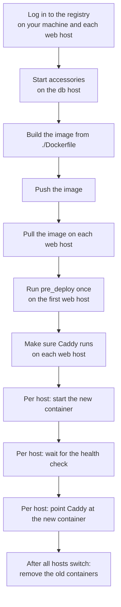

# Recipes

Ready-made starting points for common apps and tasks. Copy one, change the names, run it with `--dry-run`.

## Starter templates

`nrg init --template <name>` writes a complete `Energize.rhai` into the current directory.

| Template | What it deploys | Port | Health path | Stdlib modules |
| --- | --- | --- | --- | --- |
| `release` | A versioned directory on one host, with rollback | 8080 | `/health` | `std/release` |
| `rails` | A Rails container, rolling, with Postgres and Redis | 3000 | `/up` | `std/recipe` |
| `django` | A Django container, with Postgres and Redis | 8000 | `/health/` | `std/recipe` |
| `nextjs` | A Next.js container (Postgres only if `DATABASE_URL` is set) | 3000 | `/api/health` | `std/recipe` |
| `phoenix` | A Phoenix container, with Postgres | 4000 | `/health` | `std/recipe` |
| `laravel` | A Laravel container, with MySQL and Redis | 8000 (set 9000 for FPM) | `/up` | `std/recipe` |

The container templates all call `recipe::standard_deploy`. In order, it does this:



The deploy is fleet-atomic: if any host fails, every host goes back to the old version. The `release` template is for [directory releases](directory-releases.md) instead.

## Rails in containers

```bash
nrg init --template rails
```

The file is long because of comments. This is the working part, with the running example filled in (`nrg init` writes `myapp` names and `deploy@...` hosts, which you replace):

```rhai
import "std/recipe" as recipe;

let SERVICE = "shop";
let DB_HOST = "db1";

recipe::standard_deploy(#{
    service:           SERVICE,
    image_repo:        "ghcr.io/acme/shop",
    registry:          "ghcr.io",
    registry_user:     env_or("REGISTRY_USER", "deploy"),
    registry_password: secret("REGISTRY_PASSWORD"),
    web_hosts:         ["web1", "web2"],
    db_host:           DB_HOST,
    port:              3000,
    health_path:       "/up",
    envs: #{
        "RAILS_ENV":       "production",
        "DATABASE_URL":    reveal(secret("DATABASE_URL")),
        "SECRET_KEY_BASE": reveal(secret("SECRET_KEY_BASE")),
    },
    pre_deploy: "bin/rails db:migrate",
    accessories: [
        #{ name: SERVICE + "-db", image: "postgres:16",
           ports: #{ "5432": "5432" },
           envs: #{ "POSTGRES_DB": SERVICE + "_production", "POSTGRES_USER": SERVICE,
                    "POSTGRES_PASSWORD": reveal(secret("DB_PASSWORD")) },
           volumes: #{ "shop-db-data": "/var/lib/postgresql/data" } },
    ],
});
```

`pre_deploy` runs once, in a throwaway container started from the new image on the first web host. It runs before any traffic moves, and if it fails the deploy stops.

The full template also adds `RAILS_LOG_TO_STDOUT`, `RAILS_SERVE_STATIC_FILES`, `REDIS_URL` and a Redis accessory.

What the file expects:

| Name | Kind | Used for |
| --- | --- | --- |
| `REGISTRY_PASSWORD` | secret | Logging in to the registry |
| `DATABASE_URL` | secret | Rails database connection |
| `SECRET_KEY_BASE` | secret | Rails session signing |
| `DB_PASSWORD` | secret | The Postgres accessory |
| `DEPLOY_TAG` | environment variable | The image tag to deploy, for example a git SHA |

Secrets come from `NRG_SECRET_<NAME>` environment variables or from `.energize/secrets`. See [Secrets](secrets.md). Every secret must be at least 6 characters long, or nrg stops with `secret 'REGISTRY_PASSWORD' is too short`. `REGISTRY_USER` is optional and defaults to `deploy`. `DEPLOY_TAG` defaults to `latest`.

By default nrg builds `ghcr.io/acme/shop:<DEPLOY_TAG>` from `./Dockerfile` on your machine and pushes it. If your CI already builds and pushes the image, add `skip_build: true, skip_push: true,` to the settings.

Preview the deploy. The file has no functions, so you run it with `nrg exec`:

```bash
DEPLOY_TAG=v42 nrg exec --dry-run
```

```text
[nrg] container runtime: docker (docker)
==> Deploying shop v42

--- Registry Login ---

--- Accessories ---
  starting accessory shop-db on db1
==> Deploying shop v42 to 2 host(s)
...
--- Build ---

--- Push ---

--- Pull ---

--- Pre-deploy (new-image release task) on web1 ---
    bin/rails db:migrate

--- Proxy ---

--- Deploy (fleet-atomic) ---

  [web1]
    starting shop-web-v42-<auto> on port <auto>
    waiting for health...
  health check passed on web1 (1/30, 1/1 consecutive)
    switching traffic -> localhost:<auto>
...
shop v42 is live.
```

A dry run still reads from your hosts. It does not change anything. See [Dry run](dry-run.md) and [Deploying containers](deploy.md).

The other container templates differ in these ways:

- Django: port 8000, health path `/health/`. Secrets: `REGISTRY_PASSWORD`, `DATABASE_URL`, `DJANGO_SECRET_KEY`, `DB_PASSWORD`. `pre_deploy` runs `migrate` and `collectstatic`.
- Next.js: port 3000, health path `/api/health`. The only secret is `REGISTRY_PASSWORD`. If the `DATABASE_URL` environment variable is set, the template also starts a Postgres accessory (and needs `DB_PASSWORD`). The Prisma `pre_deploy` line is commented out; turn it on if you use Prisma.
- Phoenix: port 4000, health path `/health`. Secrets: `REGISTRY_PASSWORD`, `DATABASE_URL`, `SECRET_KEY_BASE`, `DB_PASSWORD`. `pre_deploy` is `bin/migrate`. It has no Redis accessory.
- Laravel: port 8000, health path `/up`. Secrets: `REGISTRY_PASSWORD`, `APP_KEY`, `DATABASE_URL`, `DB_PASSWORD`, `DB_ROOT_PASSWORD`. The database is MySQL. `pre_deploy` runs `migrate`, then caches config, routes and views.

Each file lists its own required secrets in the header comment. Read it before you run.

## Small recipes

Put these in an `Energize.rhai` and run them with `nrg run <function>`. Inside a function, write `global::HOSTS` to read a top-level constant.

```rhai
import "std/notify" as notify;
import "std/registry" as registry;
import "std/caddy" as caddy;

const HOSTS = ["web1", "web2"];
```

**Run a command on every host.** `ssh_exec_all` runs on all hosts at once and returns one result per host.

```rhai
fn uptime() {
    for r in ssh_exec_all(global::HOSTS, "uptime") {
        let out = r.stdout;
        out.trim();
        print(r.host + ": " + out);
    }
}
```

```bash
nrg run uptime
```

A dry run does not run `ssh_exec_all`, so `nrg run uptime --dry-run` prints `web1: ` and `web2: ` with nothing after them. Run it without `--dry-run` to see the real output, for example `web1: 10:00:00 up 5 days, ...`.

In Rhai, `trim()` changes the string in place, so the recipe copies `r.stdout` to `out` first and prints `out`.

**Restart a service on web1, then web2.** A plain loop goes one host at a time. `wait_healthy_on_host` asks the host itself for `/up`, retries (30 tries, 2 seconds apart by default) and throws if it never answers, so the loop stops before web2 is touched.

```rhai
import "std/healthcheck" as health;

fn restart() {
    for host in global::HOSTS {
        ssh_exec(host, "sudo -n systemctl restart shop");
        health::wait_healthy_on_host(host, 3000, #{ path: "/up" });
    }
}
```

`ssh_exec` does not stop on a failing command, so check the result yourself (or use a function like this one) when a step must succeed.

**Tell Slack after a deploy.** The webhook URL is a secret, so nrg hides it in the plan.

```rhai
fn announce() {
    notify::slack(secret("SLACK_WEBHOOK_URL"), "shop is live on " + global::HOSTS.len() + " hosts");
}
```

```text
PLAN (dry run — no changes made):
  check   -    [assumed ok] POST *** [planned; execution-unverified]
```

A dry run never sends the message. In a container deploy you can call it from a `hook_post_deploy(service, image, hosts)` function in the same file.

**Log in to a registry on every host.** The password goes to `docker login` through stdin, not on the command line.

```rhai
fn login() {
    registry::registry_login_all(global::HOSTS, "ghcr.io", "deploy", secret("REGISTRY_PASSWORD"));
}
```

**Turn maintenance mode on and off.** This changes the Caddy route for `shop` on web1 to a fixed 503 page. The route must already exist from a container deploy. To turn it off, you must say where traffic goes back to. A container deploy saves that address as `shop.target.<host>`, so read it back with `state_get`.

```rhai
fn maintenance_on() {
    caddy::proxy_maintenance("web1", "shop", true, #{ message: "Back soon." });
}
fn maintenance_off() {
    if !has_state("shop.target.web1") { throw "deploy shop first"; }
    caddy::proxy_maintenance("web1", "shop", false, #{
        target: state_get("shop.target.web1"),
        health_path: "/up",
    });
}
```

Run `maintenance_off` after a real deploy; without saved state there is no address to restore, so the guard stops with `deploy shop first`. `health_path` puts back the health check the deploy set up.

**Staging and production from one file.** `--dest` gives each environment its own state and its own secrets file (`.energize/secrets.staging`). Inside the script, `nrg_dest()` tells you which one is active.

```rhai
fn domain() {
    let name = if nrg_dest() == "staging" { "staging.shop.example.com" } else { "shop.example.com" };
    print("deploying to " + name);
}
```

```bash
nrg run domain --dest staging
```

```text
[nrg] destination: staging
deploying to staging.shop.example.com
```

For `nrg rollback`, use the same `--dest` as the deploy you are undoing.

## Next

- [Deploying containers](deploy.md)
- [Directory releases](directory-releases.md)
- [Standard library](stdlib.md)
