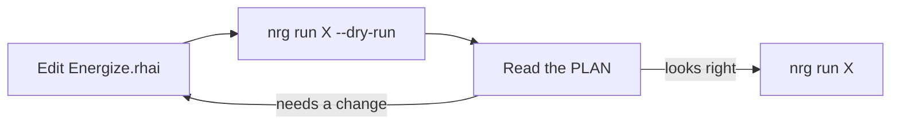

# Getting started

This page takes you from nothing to a first real run: install `nrg`, connect to a server, write a script, preview it and run it.

`nrg` runs on your machine and reaches your servers over SSH. You describe what to do in a file called `Energize.rhai`. Each function in that file is a task you can run.



## Install

The install script downloads the right build for your system, checks its sha256 checksum and puts `nrg` in `~/.local/bin`:

```bash
curl -fsSL https://raw.githubusercontent.com/inou/nrgize-rs/main/scripts/install.sh | sh
```

To install a fixed version, run:

```bash
curl -fsSL https://raw.githubusercontent.com/inou/nrgize-rs/main/scripts/install.sh | sh -s -- --version v0.3.0
```

To install into another folder, replace `--version v0.3.0` with `--bin-dir DIR`.

With Homebrew:

```bash
if brew help trust >/dev/null 2>&1; then brew trust --formula inou/nrg/nrg; fi
brew tap inou/nrg https://github.com/inou/nrgize-rs.git
brew install inou/nrg/nrg
```

With Cargo (Rust 1.95 or newer):

```bash
cargo install --git https://github.com/inou/nrgize-rs
```

Check that it works:

```console
$ nrg --version
nrg 0.3.0
```

### Homebrew troubleshooting

| Problem | Fix |
|---|---|
| `Repository not found` | Add the tap with the explicit URL shown above. `brew tap inou/nrg` alone looks for a repository that does not exist. |
| Untrusted formula or invalid syntax in tap | Run `brew trust --formula inou/nrg/nrg`, then add the tap again. Older Homebrew has no `trust` command and does not need it. |
| `nrg --version` shows an old version | Run `type -a nrg`. An older copy in `~/.local/bin` may come first on your `PATH`. Remove it or put Homebrew's `bin` first. |

To upgrade, run `brew update && brew upgrade inou/nrg/nrg`.

### Optional tools

`nrg` itself is one binary. It calls these programs on your machine only when your script needs them.

| Tool | When you need it |
|---|---|
| `ssh` | Always. Every command on a server goes through it. |
| `age` and `age-keygen` | When you use `nrg secrets` or secrets in scripts. Get them from [age](https://github.com/FiloSottile/age). |
| `docker` or `podman` | Deploying containers. It must be on the server, and on your machine when your script builds an image there. Scripts use `docker` unless they call `rt::set_runtime` to choose `podman` or `nerdctl` (see [Standard library](stdlib.md#stdruntime)). |

You do not need `rsync` or `scp`. File upload and download use `ssh`.

## Connect to your hosts

`nrg` uses your own `ssh` and your `~/.ssh/config`. A host name in a script is anything `ssh` understands, such as an alias or `user@hostname`.

```text
# ~/.ssh/config
Host web1
    HostName 203.0.113.10
    User deploy
    IdentityFile ~/.ssh/id_ed25519
```

Check that you can log in with `nrg ssh`, which opens a normal session:

```console
$ nrg ssh web1
Connecting to web1 (resolves to deploy@203.0.113.10 per ~/.ssh/config)...
```

Scripts run `ssh` without prompts (`-o BatchMode=yes -o StrictHostKeyChecking=yes`). So scripts need key or agent login, not a password or passphrase prompt, and the host key must already be in `known_hosts`. See [Add host keys first](safety.md#add-host-keys-first).

If `nrg ssh` works and those two conditions hold, scripts can use the name `web1`. `nrg` installs nothing on your servers. It runs ordinary commands over SSH.

## Create a script

Run `nrg init` in your project folder:

```console
$ nrg init
✓ Created Energize.rhai
```

It refuses to overwrite a file that already exists. The file holds a list of hosts and two tasks:

```rhai
// ... a comment header that lists the builtins ...

const HOSTS = ["user@example.com"];

// `nrg run deploy`
fn deploy() {
    for host in global::HOSTS {
        let r = ssh_exec(host, "cd /var/www/app && git pull origin main");
        if !r.ok { throw "deploy failed on " + host + ": " + r.stderr; }
    }
    print("Deployed to all hosts.");
}

// `nrg run uptime`
fn uptime() {
    ssh_exec_all(global::HOSTS, "uptime");
}
```

Change `user@example.com` to `web1`. Then list the tasks:

```console
$ nrg tasks
Functions:
  deploy
  uptime
```

Every `fn` in the file is a task. `nrg run uptime` calls `uptime()`. Extra words after the task name become its arguments, and each one arrives as a string.

`nrg` looks for `Energize.rhai` in the current folder. From a subfolder, it finds the script once the project has a `.energize/` folder (created by your first real run), an `energize.toml` file or a `.nrg-key` file (created by `nrg secrets init`). Otherwise run `nrg` from the folder that holds the script, or use `--file path/to/script.rhai` to name the script.

Inside a function, write `global::HOSTS`. The bare name `HOSTS` is not visible there. If you write `HOSTS` in `uptime()`, you get this error:

```console
$ nrg run uptime --dry-run
Error: Variable not found: HOSTS (line 23, position 18)
in call to function 'uptime' (line 26, position 1)

PLAN (dry run — no changes made):
  (no side effects)
0 action(s), 0 host(s). 0 executed.
...
```

The exit code is 1, and an empty PLAN is still printed.

## Preview with --dry-run

Add `--dry-run` to see what a task would do:

```console
$ nrg run uptime --dry-run

PLAN (dry run — no changes made):
  ssh-all web1                   uptime [planned; execution-unverified]
1 action(s), 1 host(s). 0 executed.
Reads ran against the hosts' current state (an unreachable host is assumed absent); mutations returned synthetic success, nothing carries across steps, and waits are assumed to pass.
```

A dry run lists the changes instead of making them. It still runs reads on your hosts, such as checking whether a container is running. Exit code 0 does not promise the real run will work, because commands in the PLAN are not tried.

Read [Dry run](dry-run.md) for how to read each line of a PLAN.

## Run it

Run the task for real:

```console
$ nrg run uptime
```

This task prints nothing. `ssh_exec_all` collects the output and the template ignores it. The task also exits 0 when a host fails. To see a failed step, read the audit log. Or have your task print the results.

Each real `nrg run` or `nrg exec` adds an entry to an audit log in `.energize/audit.log`. Dry runs are not logged. Show the latest entry:

```console
$ nrg audit --limit 1
2026-11-10T16:54:27Z  root@laptop  run uptime        success
  run: 18e6bd5354c7f6f5-1483389
```

A failed step shows up here even without `--verbose`, for example `step ssh_exec_all on web1 (ssh-all) exited 255: ...`. Add `--verbose` to see every step and its exit code. `nrg audit --incomplete` lists runs that never finished.

## Deploy a container

This is the script to start from when you ship a container to two servers. It deploys the image `ghcr.io/acme/shop` and serves it on `shop.example.com`:

```rhai
import "std/deploy" as deploy;

const HOSTS = ["web1", "web2"];

fn ship(tag) {
    deploy::deploy(global::HOSTS, "ghcr.io/acme/shop:" + tag, "shop", #{
        container_port: 3000,
        health_path:    "/up",
        domain:         "shop.example.com",
    });
}
```

The dry run shows the order: lock, build, push, pull, set up the proxy (Caddy), start the new container on each host, switch traffic, remove the old one.

```console
$ nrg run ship v1 --dry-run
==> Deploying shop v1 to 2 host(s)
...
==> Deploy complete: shop v1

PLAN (dry run — no changes made):
  lock    web1       mkdir /tmp/nrg-deploy-lock-shop (owned deploy lock) ...
  lock    web2       mkdir /tmp/nrg-deploy-lock-shop (owned deploy lock) ...
  local   -          docker build -t 'ghcr.io/acme/shop:v1' -f 'Dockerfile'  '.' ...
  local   -          docker push 'ghcr.io/acme/shop:v1' ...
  ssh-all web1       docker pull 'ghcr.io/acme/shop:v1' ...
  ...
  ssh     web1       docker run -d --restart unless-stopped --name 'shop-web-v1-<auto>' ...
  ...
55 action(s), 2 host(s). 0 executed.
```

Read [Deploying containers](deploy.md) before the first real run. It covers the Dockerfile, registry login, server setup and rollback. Registry passwords are stored encrypted; see [Secrets](secrets.md).

## Check your setup with nrg doctor

`nrg doctor` checks that your script compiles. Add `--host` to test that each server answers over SSH:

```console
$ nrg doctor --host web1

Energize Doctor

  ✓ Orchestration file found: /home/you/shop/Energize.rhai
  ✓ [syntax only] /home/you/shop/Energize.rhai compiles (2 function(s) defined)

  Tools:
  No deployment-specific checks declared (--checks FILE). Runtime compatibility unverified.

  Hosts:
  ✓ web1: SSH reachable (read-only; runtime not requested)

✓ All checks passed!
```

A passing doctor means the file compiles and the host answers. It does not prove a deploy will work. See [Safety and limits](safety.md#known-limits).

## Next

- [Writing scripts](authoring.md): variables, functions, arguments and the helpers `nrg` gives you.
- [Deploying containers](deploy.md): the full container workflow, with health checks and rollback.
- [Directory releases](directory-releases.md): ship a build folder to a server and switch to it.
