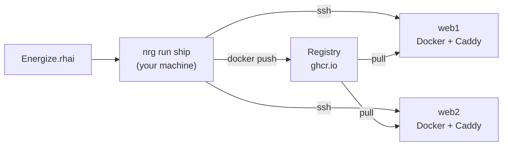

# Energize (`nrg`)
{: .fs-9 }

You write your deploy script in Rhai, on your machine. Each function in `Energize.rhai` is a task, and you run one with `nrg run <task>`.
`nrg` reaches your servers over plain SSH, with no agent to install, and ships a standard library for zero-downtime container deploys behind Caddy and for directory releases.
{: .fs-6 .fw-300 }



## A complete deploy

Save this as `Energize.rhai`. It ships the image `ghcr.io/acme/shop` to two hosts and serves it at `shop.example.com`.

```rhai
import "std/deploy" as deploy;

fn ship(tag) {
    deploy::deploy(["web1", "web2"], "ghcr.io/acme/shop:" + tag, "shop", #{
        container_port: 3000,
        health_path:    "/up",
        domain:         "shop.example.com",
    });
}
```

Before you run it, check three things: a Dockerfile in this folder, push access to `ghcr.io/acme`, and Docker on each host. See [Getting started](getting-started.md).

First look at the plan. A dry run reads from your hosts but changes nothing:

```console
$ nrg run ship v1 --dry-run
```

It prints the order of steps, then one line per action, each marked `[planned; execution-unverified]`. See [Dry run](dry-run.md) for the full output.

Then run it for real:

```console
$ nrg run ship v1
```

`nrg` builds and pushes the image, starts the new container on each host, waits for the health check, and then switches traffic.
If any host fails its check, it tries to put the old version back on every host it already switched.

Upgrading from 0.1.x? See the [0.2.0 notes](releases/v0.2.0.md).

## Pick your path

| I want to... | Read |
|---|---|
| Deploy something today | [Getting started](getting-started.md) |
| Ship Docker images | [Deploying containers](deploy.md) |
| Ship a build directory or a binary | [Directory releases](directory-releases.md) |
| Handle passwords and tokens | [Secrets](secrets.md) |
| See what will happen first | [Dry run](dry-run.md) |
| Look something up | [CLI](cli.md), [Builtins](builtins.md), [Standard library](stdlib.md) |
| Know what can go wrong | [Safety and limits](safety.md) |

## Install

```bash
curl -fsSL https://raw.githubusercontent.com/inou/nrgize-rs/main/scripts/install.sh | sh
```

Or with Homebrew:

```bash
if brew help trust >/dev/null 2>&1; then brew trust --formula inou/nrg/nrg; fi
brew tap inou/nrg https://github.com/inou/nrgize-rs.git
brew install inou/nrg/nrg
```

Newer Homebrew needs the trust step. Other options and Homebrew fixes are in [Getting started](getting-started.md#install).

## Next

- [Getting started](getting-started.md)
- [Guides](guides.md)
- [Reference](reference.md)
