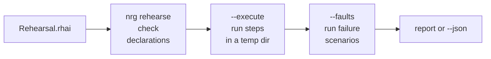

# Testing a deploy

This page shows four ways to find problems before a live deploy touches your servers.

| Tool | What it checks | Touches your hosts? |
| --- | --- | --- |
| `nrg doctor` | Your script compiles. Checks you declared pass. | Yes: the hosts you name with `--host`, or every host from earlier deploys |
| `--dry-run` | The plan for a real command. See [Dry run](dry-run.md). | Reads only, no changes |
| `preflight()` or `--checks` | A host can do what your deploy needs. | Yes, runs your probe commands |
| `nrg rehearse` | Your deploy steps survive repeats and injected failures. | No. Runs on your machine |

## nrg doctor

Run it in the folder with your `Energize.rhai`:

```sh
nrg doctor
```

```text
Energize Doctor

  ✓ Orchestration file found: /home/you/shop/Energize.rhai
  ✓ [syntax only] /home/you/shop/Energize.rhai compiles (0 function(s) defined)

  Tools:
  No deployment-specific checks declared (--checks FILE). Runtime compatibility unverified.

✓ All checks passed!
```

Doctor only compiles the script. It does not run it, and it does not prove your servers are ready. To check a server, declare checks in a JSON file. This `checks.json` has three:

```json
[
  {"name": "deploy script is valid bash", "kind": "syntax", "command": "set -eu\ndocker pull ghcr.io/acme/shop:1.0"},
  {"name": "docker is installed", "kind": "read-only", "host": "web1", "command": "docker --version"},
  {"name": "local dir keeps 0600", "kind": "file-permissions", "directory": "."}
]
```

```sh
nrg doctor --checks checks.json --host web1 --allow-temporary
```

```text
  Tools:
[preflight:syntax] deploy script is valid bash: passed
[preflight:read-only] docker is installed: passed
[preflight:temporary-write] local dir keeps 0600: passed

  Hosts:
  ✓ web1: SSH reachable (read-only; runtime not requested)

✓ All checks passed!
```

| Flag | What it does |
| --- | --- |
| `--checks FILE` | Reads the checks from a JSON array. |
| `--host NAME` | Checks SSH reachability for this host. Repeat for more hosts. Without it, doctor uses the hosts recorded from earlier deploys. If a host has a recorded image, doctor also looks for `docker`, `podman` or `nerdctl` on it. On a Docker host it runs `docker manifest inspect` for each recorded image to test your registry login. |
| `--allow-temporary` | Lets `file-permissions` and `rsync-permissions` checks create a temporary directory. Without it, preflight rejects the whole list and runs none of the checks. A failing check stops the checks after it. |
| `--legacy-tools` | Also requires `age`, `ssh`, `rsync` or `scp`, and `docker` or `podman` on your `PATH`. Turns on the container runtime check for every host. |
| `--file FILE` | Uses a script other than `Energize.rhai`. |

Doctor exits 0 when everything passes and 1 when a check fails.

A `read-only` check runs the command you wrote, on the host, so keep it harmless. Here is what each kind does:

| Kind | What it runs | Needs `command`? | Needs `--allow-temporary`? |
| --- | --- | --- | --- |
| `read-only` | Your command, on `host` | Yes | No |
| `syntax` | `bash -n` on your command, on your machine or on `host` if you set it | Yes | No |
| `file-permissions` | Makes a temporary folder under `directory` (default `.`) and checks that a copied file ends up with mode 600 | No | Yes |
| `rsync-permissions` | The same check, for a file copied with rsync | No | Yes |

See `preflight` in [Builtins](builtins.md) for every field.

## preflight in a script

Run the same checks as the first step of a deploy. If one fails, the script stops before it changes anything.

```rhai
fn deploy_shop() {
    preflight([
        #{ name: "docker is installed", kind: "read-only", host: "web1", command: "docker --version" },
        #{ name: "deploy dir keeps 0600", kind: "file-permissions", directory: "." }
    ], true);
    print("checks passed, deploying");
}
```

The second argument is `allow_temporary`. Pass `true` to allow checks that create a temporary directory.

Save the function in `Energize.rhai` and run `nrg run deploy_shop`. To keep it in another file, such as `Pre.rhai`, name it:

```sh
nrg run --file Pre.rhai deploy_shop
```

```text
[preflight:read-only] docker is installed: passed
[preflight:temporary-write] deploy dir keeps 0600: passed
checks passed, deploying
```

With `--dry-run`, `read-only` checks still run on the host. Checks that write are skipped and marked in the plan.

## Rehearsal contracts

A rehearsal runs your own commands on your own machine, in a fresh temporary folder. You write a contract: what to run, what to check afterwards, and which failures to cause on purpose.

Save this as `Rehearsal.rhai`. That is the file `nrg rehearse` reads by default. To use another file, pass it: `nrg rehearse my-contract.rhai`.

```rhai
import "std/contracts" as c;

c::service(#{
    name: "shop release",
    deploy: c::step("install v1", "printf v1 > current"),
    restart: c::step("restart", "test -f current"),
    checks: [c::step("v1 is live", "test \"$(cat current)\" = v1")],
    cleanup: [c::step("remove release", "rm -f current")],
    faults: [c::rejects("bad candidate is rejected", "exit 42", 42, [
        c::step("v1 is still live", "test \"$(cat current)\" = v1")
    ])]
})
```



Run it three ways. Each adds more.

```sh
nrg rehearse                    # only check the declarations
nrg rehearse --execute          # also run the steps
nrg rehearse --execute --faults # also run the failure scenarios
```

The first form runs no commands:

```text
first install / install v1: planned; execution-unverified (expected 0, actual unverified)
...
bad candidate is rejected / bad candidate is rejected: skipped (expected 42, actual unverified)
...
Rehearsal 'shop release': execution-unverified
No commands ran. Use --execute for trusted local commands; --faults enables declared fault scenarios.
```

With `--execute --faults`, every step runs. Progress lines such as `[nrg] rehearsal first install / install v1 (local action)` go to stderr as it works. The report below goes to stdout:

```text
first install / install v1: passed (expected 0, actual 0)
first install / v1 is live: passed (expected 0, actual 0)
repeat install / install v1: passed (expected 0, actual 0)
...
restart / v1 is live: passed (expected 0, actual 0)
bad candidate is rejected / bad candidate is rejected: passed (expected 42, actual 42)
bad candidate is rejected / v1 is still live: passed (expected 0, actual 0)
cleanup / remove release: passed (expected 0, actual 0)
Rehearsal 'shop release': passed
```

Without `--faults`, the failure scenarios are listed as `skipped`.

`service` builds three scenarios for you: first install, repeat install and restart. It then adds your `faults`. Each of the three built-in scenarios runs your `checks` afterwards. A fault runs only the checks you give it. `setup` steps, if any, run first, and `cleanup` runs last.

| Helper | Use it for |
| --- | --- |
| `step(name, command)` | A command that must exit 0. |
| `rejects(name, command, exit_code, checks)` | A failure that must exit with exactly this code (1 to 125), then checks that must pass. |
| `fault(name, steps, checks)` | A failure made of several steps, such as kill then restart. |
| `scenario(name, steps, checks)` | Your own scenario, if `service` does not fit. |
| `service(cfg)` | The usual lifecycle. Needs `name`, `deploy`, `restart`, `checks` and `cleanup`. Accepts `setup`, `env` and `faults`. |

Every step is a fresh `/bin/sh -c`. Files stay between steps. Shell variables and `cd` do not. A step is a map, so you can set `timeout_secs` (1 to 3600, default 60) and `stdin`:

```rhai
let s = c::step("wait", "sleep 5");
s.timeout_secs = 120;
```

Leaving out a required key is an error (`invalid contract schema`, exit 2), not a skipped test.

| Flag | What it does |
| --- | --- |
| `FILE` | The contract to read. Default: `Rehearsal.rhai`. |
| `--dry-run` | The default mode. Runs no commands; with `--faults`, fault steps show as `planned; execution-unverified` instead of `skipped`. You cannot combine it with `--execute`. |
| `--execute` | Runs the commands. Without it, nothing runs. |
| `--faults` | Includes the scenarios marked as faults. Add `--execute` to run them. |
| `--json` | Prints one JSON report on stdout. Progress still goes to stderr. |
| `--env NAME` | Passes this environment variable to your commands and hides its value in output. Repeat for more. Give the name only, not `NAME=value`. Names such as `HOME`, `TMPDIR`, `PWD`, `BASH_ENV`, `NRG_*` and `XDG_*` are reserved and rejected. With `--execute`, a variable that is not set is an error. Example: `nrg rehearse --execute --env API_TOKEN`. |

Commands get only `PATH`, your contract's `env`, any `--env` names, and these:

| Variable | Value |
| --- | --- |
| `NRG_WORKSPACE` | The temporary folder. Put files here. |
| `NRG_SOURCE` | The folder holding your contract. Copy fixtures from here. |
| `NRG_BIN` | The path of the running `nrg`. |

`HOME`, `TMPDIR` and the `XDG_CONFIG_HOME`, `XDG_CACHE_HOME`, `XDG_DATA_HOME` and `XDG_STATE_HOME` folders also point inside the workspace.

A contract runs in a restricted engine. It can import only `std/contracts` and `std/release_recipes`, and it cannot call nrg builtins such as `ssh_exec` or `preflight`. You cannot reuse functions from your `Energize.rhai`.

## What rehearsal does not do

- It does not connect to your hosts. There is no SSH. Everything runs on the machine where you typed the command.
- It is not a sandbox. Your commands have your normal file and network access, so write them for throwaway resources.
- It does not install runtimes. Anything your commands need must already be on `PATH`.
- It does not prove your framework or servers work. It proves the steps you wrote behave as you declared.
- Your cleanup must stop anything it started. Deleting the temporary folder does not stop a background process.

If a step fails, later steps are skipped. Cleanup still runs.

## In CI

```sh
nrg rehearse --execute --faults --json > rehearsal.json
```

Keep `rehearsal.json` as a build artifact. It lists every step with its scenario, expected and actual exit code, status and duration. Commands and secret values are left out. Each step that exited non-zero also carries an `excerpt` of its output, with secrets hidden, so failures show up in the file. The report also names the `workspace` and whether it was removed (`workspace_removed`).

| Exit code | Meaning |
| --- | --- |
| 0 | The declarations are valid, or the selected steps passed. |
| 1 | A step failed, or the workspace could not be removed. |
| 2 | The arguments or the contract are invalid. |
| 130 | You interrupted it. |

Exit 0 without `--execute` only means the contract is valid. Add `--execute` in CI so it runs the steps.

## Next

- [Dry run](dry-run.md)
- [Recipes](examples.md)
- [CLI](cli.md)
