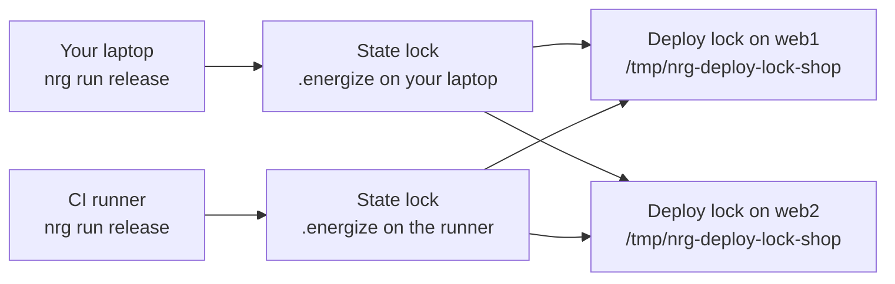

# Safety and limits

This page explains what `nrg` protects you from, how it does it, and what it cannot do.

`nrg` runs commands on your servers over SSH. A few simple mechanisms keep that safe to do from a laptop or a CI job. Each section also says where the protection stops.

## At a glance

| Mechanism | Protects you from | Limit |
| --- | --- | --- |
| State lock | Two `nrg` runs on one machine writing the same project state at once | Local to one machine and one project folder. It does not stop a second machine. |
| Deploy lock | Two machines deploying the same service to the same hosts at once | A lock on each host, per service. It has no expiry, so a crashed run can leave it held. |
| Release lock | Two directory releases in the same release root at once | One lock per release root on the host. No expiry. |
| [Transactions](authoring.md#errors-transactions-and-rollback) | A half-finished script that leaves earlier steps in place | Only undoes steps where you wrote an `on_rollback` (your own undo code). That code must be correct. |
| Secret redaction | Passwords and tokens showing up in logs, plans and errors | Hides exact matches only. A transformed value (base64, hashed) is not caught. |
| SSH host-key checking | Sending passwords and files to the wrong machine | You must add each host's key to `known_hosts` first. |
| Dry run | Surprises before a live run | It still reads from your hosts, and it assumes health checks pass. See [Dry run](dry-run.md). |

## Where your project lives

`nrg` keeps its files in a project folder. It finds that folder by looking in your current directory, then in each parent directory, for one of these:

- a `.energize/` directory
- an `energize.toml` file
- a `.nrg-key` file

The first match is your project root. If nothing matches, the current directory is the root. Running `nrg` in a Git repository does not make the repository root the project root.

Two rules keep this safe:

- `nrg` never searches above your home directory. It also refuses to use your home directory itself as a root unless a marker is there.
- A folder chosen because it holds a marker must belong to you and must not be writable by other users. If it is not, `nrg` stops and tells you why. This stops another user from planting an `Energize.rhai` and a marker in a shared folder like `/tmp` and having it run as you. It also means `sudo nrg` against your own checkout is refused when the checkout has a marker such as `.energize/`.

Everything `nrg` writes goes in `.energize/`:

| File | What it holds |
| --- | --- |
| `state.json` | What is deployed: images, versions, hosts, saved configs |
| `state.json.bak` | The copy of `state.json` from before the last write |
| `state.lock`, `state.write.lock` | The local locks (empty files) |
| `audit.log` | One entry per live `nrg run`, `exec` or `rollback`, plus begin and outcome lines for `setup`, `remove`, `lock`, `app` and `secrets` |
| `runs.jsonl` | A step-by-step journal of each run |
| `secrets`, `secrets.<dest>` | Encrypted secrets. This is the only part you commit. |

To commit the encrypted secrets and nothing else, use the `.gitignore` block in [Secrets](secrets.md#what-to-commit).

## Locks

Three locks work at different places. Two of them keep runs apart; the third guards directory releases.



Each machine has its own state lock, so it cannot see the other one. The deploy lock lives on the hosts, so both machines meet there. The second one to arrive stops.

### State lock

Each live `nrg run`, `exec`, `rollback`, `setup` or `remove` takes an exclusive lock on `.energize/state.lock` and holds it until the run ends. A second run in the same project waits and prints:

```
Waiting for the state lock (another `nrg` run is in progress under <root>)...
```

By default it waits for as long as it takes. In CI you usually want it to fail fast instead:

```sh
nrg run release --lock-timeout 120
```

After 120 seconds `nrg` gives up with an error that says another run appears to be holding the lock. `--lock-timeout` works on `nrg run`, `nrg exec` and `nrg rollback`.

A script that runs `nrg` inside itself does not deadlock. The inner `nrg` sees that an outer run in the same project is alive and reuses its lock.

A dry run takes no lock and writes no files.

The state lock only keeps `nrg` runs on one machine apart. It does not stop someone from editing `state.json` by hand.

### Deploy lock

`deploy()` from `std/deploy` creates a directory named `/tmp/nrg-deploy-lock-<service>` on every host it deploys to. `mkdir` either creates the directory or fails, so only one deploy of that service can hold it. The lock is released when the deploy finishes or fails. `rollback()` takes the same lock.

You can see it in a dry run. Here is the lock part of the plan for the `shop` service on `web1` and `web2`:

```
PLAN (dry run — no changes made):
  lock    web1   mkdir /tmp/nrg-deploy-lock-shop (owned deploy lock) [planned; execution-unverified]
  lock    web2   mkdir /tmp/nrg-deploy-lock-shop (owned deploy lock) [planned; execution-unverified]
  local   -      docker build -t 'ghcr.io/acme/shop:v1' -f 'Dockerfile'  '.' [planned; execution-unverified]
  ...
```

If another deploy of `shop` holds the lock, your deploy stops before it changes anything.

Check, take or free the lock yourself with `nrg lock`:

```sh
nrg lock status shop --host web1
nrg lock acquire shop --host web1
nrg lock release shop --host web1 --yes
```

`nrg lock status` prints this for a free lock:

```
shop: not locked (checked web1)
```

and this for a lock taken with `nrg lock acquire`:

```
shop: LOCKED on web1 by alice at 2026-11-10 17:24:48 UTC (via nrg lock acquire)
  /tmp/nrg-deploy-lock-shop
```

A lock held by a running `deploy()` or `rollback()` shows a random token instead of your name (`LOCKED on web1 by <token>`).

`nrg lock acquire` is for a maintenance window: while you hold the lock, deploys of that service refuse to run. It prints `Automated deploys/rollbacks of this service will refuse to run until this lock is released.` It does not deploy anything.

`nrg lock release` without `--yes` only prints what it would do (`Would release "shop"'s lock on web1 (held by ...).`). Use `--yes` only when you are sure no deploy of that service is still running.

If a service has more than one host in the state file, pass `--host`. `nrg` will not guess which host holds the lock. See [CLI](cli.md#nrg-lock) for every flag.

To turn the deploy lock off for one call, set `skip_lock: true` in the config map you pass to `deploy()`:

```rhai
deploy::deploy(["web1", "web2"], "ghcr.io/acme/shop:v1", "shop", #{
    domain: "shop.example.com",
    skip_lock: true,
});
```

Do this only if a host has no writable `/tmp`. Without the lock, two deploys can pick the same port or leave the wrong container named `shop-web`.

The lock has no expiry. `nrg` releases it when a deploy fails or you press Ctrl-C once. A second Ctrl-C quits at once and leaves it held. `kill -9`, a crash, a power cut or a lost network connection can also leave it held. The next deploy then refuses to run until you run `nrg lock release shop --host web1 --yes`. An expiry could let two deploys run together on a slow but healthy host, which is worse than clearing a lock by hand.

### Release lock

`deploy()` from `std/release` (directory releases) takes a lock directory named `.nrg-release-lock` inside the release root on the host. It is released when the deploy or rollback finishes or fails. `nrg lock` does not manage it. If a crash leaves it behind, remove the directory with `ssh web1 rm -rf <root>/.nrg-release-lock`. See [Directory releases](directory-releases.md).

## State file

`state.json` is the record of what is deployed. `nrg rollback` and `nrg status` read it.

`nrg` writes it in a way that survives a crash:

1. It copies the current file to `state.json.bak`.
2. It writes the new content to a private temporary file and flushes it to disk.
3. It renames the temporary file over `state.json`. A rename is atomic, so you see the old file or the new file, never half of one.

Both files are readable only by you (mode `0600`).

A file that does not parse is not ignored. `nrg` stops, so it cannot silently forget your deploy history:

```
Error: CORRUPT state file .../.energize/state.json (key must be a string at line 1 column 2). Refusing to run to avoid losing deploy history — inspect or restore it. A backup from the previous write may exist at .../.energize/state.json.bak. Once fixed, re-run.
```

To recover, look at the file. If it is damaged, copy the backup over it and run again:

```sh
cp .energize/state.json.bak .energize/state.json
```

A state file written by a newer `nrg` is also refused. Upgrade `nrg` instead of downgrading the file.

**The state file can contain secrets in plain text.** After each deploy, `deploy()` saves the full config under the key `<service>.config`, and the previous one under `<service>.prev_config`. If you passed a secret into `envs` with `reveal(secret("..."))`, the real value is saved. `rollback()` needs it to start the old container with the same settings.

The `0600` mode protects the file from other users on the same machine. Nothing else does, so:

- Never commit `.energize/`, apart from the encrypted secrets files.
- Do not upload `.energize/` as a CI artifact.
- Treat any backup of `state.json` as a secret.

See [Secrets](secrets.md) for how to handle secrets in scripts.

## Audit log and run journal

Two files in `.energize/` record what you ran. Both are readable only by you.

- `audit.log` has one entry for each live `nrg run`, `exec` and `rollback`: who, from which machine, which function, and the outcome. `setup`, `remove`, `lock`, `app` and `secrets` write a begin line and an outcome line. It answers "who deployed this, and when?". Dry runs of `run`, `exec` and `rollback` are not recorded.
- `runs.jsonl` is a journal of each run. It records when the run began, each named step with its host and exit code, and how it ended.

Read them with `nrg audit`. With no flag it shows `audit.log`; `--run` and `--incomplete` read the journal:

```sh
nrg audit                     # the last 20 audit.log entries, newest first
nrg audit release             # only audit.log entries that mention "release"
nrg audit --run <RUN_ID>      # every journal event for one run
nrg audit --incomplete        # runs that never recorded an ending
```

A run with no ending was killed, crashed, or is still running. `nrg audit --incomplete` starts with this reminder, before the events:

```
Runs without a completion event may still be running. Inspect before retrying.
```

The journal records every command that changes something: `ssh_exec`, `local_exec`, `ssh_step`, `local_step` and the standard library calls built on them. Read-only probes such as `ssh_probe` are not recorded. For each command the journal keeps the step name, the host and the exit code. On a failure it also keeps a short tail of the error output, not the full output. Secrets are hidden in both files.

## SSH

Every `ssh` command that `nrg` runs for a script or a deploy sets these options.

`nrg ssh` and `nrg app exec` are different. `nrg ssh` runs a plain `ssh <host>` with no options. `nrg app exec` sets only `BatchMode` (not with `-i`, which opens a terminal) and the keep-alive options. Both use your own ssh settings for host keys, so `NRG_SSH_HOST_KEY_CHECKING` does not apply to them.

| Option | Effect |
| --- | --- |
| `BatchMode=yes` | Never asks for a password or a prompt. A connection that needs one fails. |
| `StrictHostKeyChecking=yes` | Refuses a host whose key is not already in `known_hosts`. |
| `ConnectTimeout=10` | Gives up after 10 seconds if the host does not answer. |
| `ServerAliveInterval=15`, `ServerAliveCountMax=4` | Drops a connection that goes silent. |
| `ControlMaster=auto`, `ControlPersist=60s` | Reuses one open connection for repeated calls to a host. |

Passwords and env files travel over these connections, so `nrg` refuses to talk to a host it has not verified.

### Add host keys first

On a new machine or CI runner, `known_hosts` is empty and the first connection fails. Add the key before you run `nrg`. Do not take it blindly from the network:

```sh
ssh-keyscan -H web1 >> ~/.ssh/known_hosts
```

Then check the fingerprint against the one the server reports about itself. Run this on the server itself, for example in your provider's web console:

```sh
ssh-keygen -lf /etc/ssh/ssh_host_ed25519_key.pub
```

and compare it with what you stored:

```sh
ssh-keygen -lf ~/.ssh/known_hosts
```

In CI, run `ssh-keyscan` once on a machine you trust, check the fingerprints, and store the result as a CI secret. Write it to `~/.ssh/known_hosts` at the start of each job. Running `ssh-keyscan` inside the job accepts whatever answers, which is no safer than trusting on first use.

### Change the policy

`NRG_SSH_HOST_KEY_CHECKING` changes the host-key policy:

| Value | Meaning |
| --- | --- |
| `yes` | The default. Unknown hosts are refused. |
| `accept-new` | Trust a host the first time you see it and remember its key. The first connection is not verified. |
| `no` or `off` | No checking. Do not use this. |
| `ask` | Behaves as a refusal, because `BatchMode` never prompts. |

Any other value is ignored and the default applies, so a typo cannot weaken the policy.

`NRG_SSH_CONTROL_PERSIST=off` turns connection sharing off. Do this if a jump host does not handle shared connections.

## Limits on commands

Every command that `nrg` runs has a time limit and an output limit, so a hung or noisy command cannot stall a deploy forever or fill your memory.

| Variable | Default | Effect |
| --- | --- | --- |
| `NRG_COMMAND_TIMEOUT_SECS` | `600` | Longest a single command may run, in seconds. The default for each command. A command over the limit is stopped and reported as a failure. For ssh, `nrg` stops its local `ssh` process; the remote command may keep running. `ssh_step` and `local_step` take a `timeout_secs` option that overrides this. |
| `NRG_MAX_OUTPUT_BYTES` | `16777216` (16 MiB) | Most output one command may produce. Output over the limit makes the command fail with `command output exceeded limit`. The command is not stopped early, but it is marked failed and its output is cut off at the limit. `ssh_step` and `local_step` stream their output and keep only the last 8 KiB. |

A value that is not a positive number is ignored and the default applies.

Raise the time limit for a slow build:

```sh
NRG_COMMAND_TIMEOUT_SECS=1800 nrg run release
```

The limits apply to `ssh_exec`, `local_exec`, steps, and the standard library calls built on them. They do not apply to `http_*` calls. See [Known limits](#known-limits).

## Trust model

`nrg` is a tool for people who already have access to the servers. It does not add a permission layer on top.

- **Whoever can run `nrg` in your project can do what your SSH keys allow.** The `Energize.rhai` file can run any command on any host you can reach, and on your own machine. Review changes to it like code that deploys.
- **The age key has no passphrase.** `nrg secrets` encrypts with [age](https://age-encryption.org). `nrg secrets init` writes `.nrg-key`. Anyone who can read the file can decrypt every encrypted secret. `nrg` sets it to mode `0600`, refuses a key that belongs to another user, and warns if it is not ignored by Git. If you need a passphrase, keep the secret in your own secret manager and pass it as an environment variable `NRG_SECRET_<NAME>`.
- **The key never goes to a build host.** When you build on another machine with `build_host`, `nrg` copies your build folder there but skips `.nrg-key`, `.nrg-key.pub`, `.energize/` and `.env` at the top of the folder. A folder that holds only those files fails before anything is sent.
- **`sh_quote` is plain POSIX quoting.** `sh_quote(value)` wraps a value in single quotes so that spaces, `$` and backticks stay literal. Use it whenever you put a value into a shell command that you build yourself.
- **Raw shell strings are trusted input.** `nrg` quotes the values it puts into a command. These fields are the exception. They are pasted in as written:

  | Field | Where |
  | --- | --- |
  | `extra` | The config for `docker_run`. Extra options, inserted into `docker run` before the image name. |
  | `command` | `docker_run_once`, `docker_exec` and `runtime_exec_cmd`. |
  | `pre_deploy` | The config for `deploy()`. A release command (for example `bin/rails db:migrate`) that runs once in a throwaway container of the new image. |
  | `pre_deploy_undo` | The config for `deploy()`. Undoes `pre_deploy` (for example `bin/rails db:rollback`) in a throwaway container of the new image, if a later step fails and every host was restored, or on a rollback that asks for it. |
  | `pre_deploy_cmd` | The config for `deploy()`. Runs on each host before the switch. |
  | `post_deploy_cmd` | The config for `deploy()`. Runs on each host after the switch. |

  Build these only from text you wrote. Never build them from a webhook body, a pull request title or any other outside input. Do not put secrets in them. Pass secrets through `envs` or `ssh_exec_stdin`. If you must include a value, wrap it in `sh_quote` first.
- **Secret redaction is exact-match.** Secrets are replaced with `***` in printed output, errors, plans, logs, and the audit files. A secret that your script changed first (base64, hashed, split across lines) is not recognised. A secret shorter than 6 characters is refused by `secret()`. `reveal()` gives you the plain text, and from then on it is up to you.

## Known limits

What `nrg` does not do:

- **Rollback goes back one step.** `nrg rollback` redeploys the image saved as `<service>.prev`, or the image you give with `--image`. It does not keep a history of versions to pick from. It also does not undo database migrations or restore volume data, so an older image can meet a database that a newer one changed.
- **`--dest` separates state, not containers.** `--dest staging` keeps its own state and secrets, but the container is always named `<service>-web`. Two destinations on one host would replace each other. Give each destination its own hosts.
- **`http_*` calls are not under the command time limit.** `http_get` and the others have their own timeout, 30 seconds by default, and nothing stops a script from retrying them for longer. They also do not follow redirects. A redirect is returned as the answer.
- **Interrupted runs do not resume.** `nrg` never continues a run on its own. After a crash, a Ctrl-C or a lost connection, run `nrg audit --incomplete` and `nrg status shop`, work out where the run stopped, and only then retry.
- **Interrupted cutovers need you.** If a traffic switch is cut off or its result is unclear, `nrg` keeps the new container and a record of the switch (`<service>.transition.<host>` in the state file). The next deploy to that host refuses to run until you check which version is live and clear the record. In a script, `state_del("shop.transition.web1")` clears it; `nrg remove` clears it too.
- **A fleet can end up mixed.** A rolling deploy across several hosts undoes itself if it fails, but if the control machine dies or the network drops half way, some hosts can run the new image and some the old one. Run `nrg status shop` to see which.
- **Transactions are only as good as your undo code.** `transaction()` runs your `on_rollback` code in reverse order after a failure, and carries on if one of them fails. Steps without an `on_rollback` are not undone. Ctrl-C is checked between operations, not in the middle of one.
- **`docker_cleanup` works on the whole host.** It runs `container prune -f` and `image prune -f`: it removes all stopped containers and all dangling images on the host, for every service. Call it only where that is acceptable.
- **A dry run does not prove a deploy will work.** It reads from your hosts but does not check disk space, permissions or the network path for a real transfer. See [Dry run](dry-run.md) and [Testing a deploy](rehearsal.md).
- **The crate is not on crates.io.** `cargo install nrg` does not work. See [Getting started](getting-started.md) for the supported ways to install.

## Next

- [Secrets](secrets.md): keep passwords and tokens out of your scripts and logs.
- [Dry run](dry-run.md): see what a run will do before it does it.
- [Architecture](architecture.md): how the pieces of `nrg` fit together.
