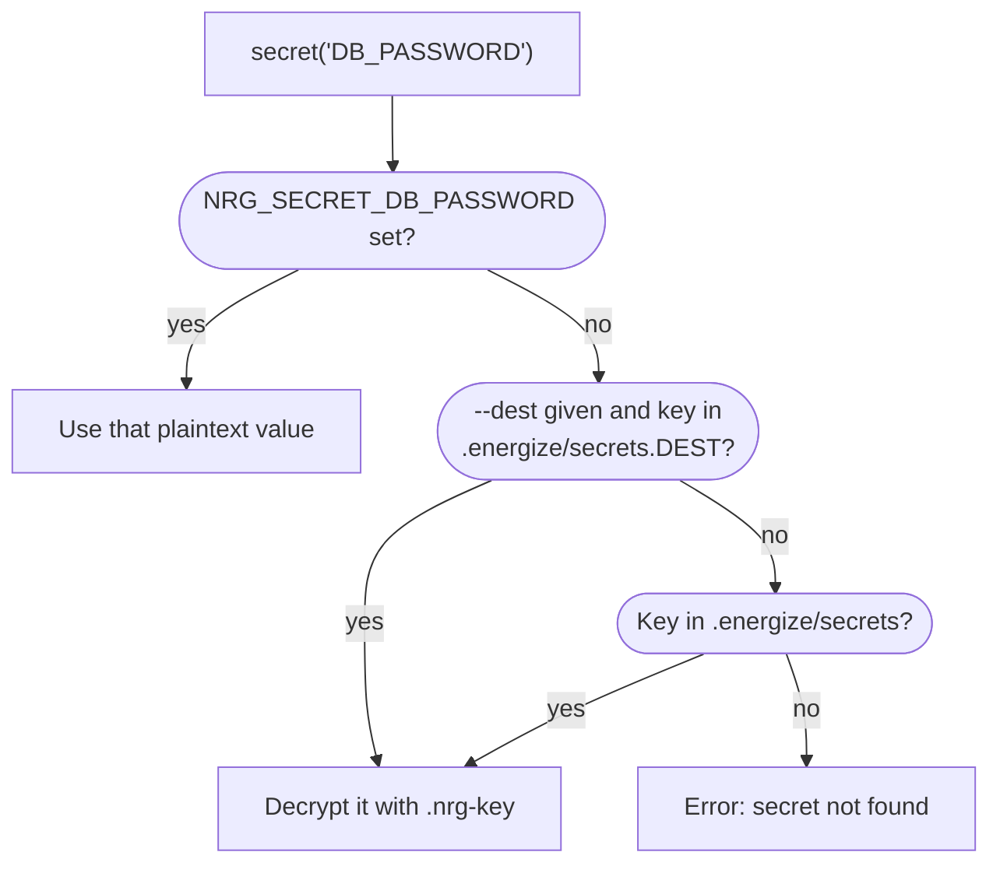

# Secrets

This page shows how to give your scripts passwords and tokens without putting plaintext in git or in logs.

## The whole flow

Four steps: make a key, encrypt a value, read it in a script, check the plan. Install [`age`](https://github.com/FiloSottile/age) first (`brew install age` or `apt install age`). nrg runs the `age` and `age-keygen` programs to make keys and encrypt.

Make a key pair in your project folder:

```console
$ nrg secrets init
  ✓ Generated key pair:
    Private key: .../shop/.nrg-key
    Public key:  .../shop/.nrg-key.pub

  ⚠ .nrg-key is NOT in .gitignore and you're in a git repo — committing it would leak your private key. Add this line to .gitignore now:
      .nrg-key
    The public key (.nrg-key.pub) is safe to commit.
  Add a secret: printf %s VALUE | nrg secrets encrypt KEY [--dest D]
```

Add the line it asks for to `.gitignore` (the [full block](#what-to-commit) is below). Then encrypt a value. The value comes from stdin, so it never lands in your shell history:

```console
$ printf %s "s3cret-pass" | nrg secrets encrypt DB_PASSWORD
  Encrypting to public key: .../shop/.nrg-key.pub
✓ Set DB_PASSWORD in .energize/secrets (ciphertext — safe to commit)
```

Use it in `Energize.rhai`:

```rhai
fn show() {
    let pw = secret("DB_PASSWORD");
    ssh_exec("web1", "echo " + sh_quote(pw));
}
```

Check the plan. The password is hidden:

```console
$ nrg run show --dry-run

PLAN (dry run — no changes made):
  ssh     web1                   echo *** [planned; execution-unverified]
1 action(s), 1 host(s). 0 executed.
...
```

A live run (`nrg run show`) sends the real value to `web1`. Only the plan and the logs hide it.

## Where nrg looks

`secret("DB_PASSWORD")` checks three places and uses the first hit.



- The environment variable is for CI. It holds the plaintext.
- The per-destination file is checked first. It does not replace the shared file: a key that exists only in `.energize/secrets` still works for every destination.
- A file that defines the key but is refused (see [the rules](#using-a-secret-in-a-script)) is an error. nrg does not fall through to another source.

The variable name is the key in upper case, so `secret("db_password")` reads `NRG_SECRET_DB_PASSWORD`. The `.energize/secrets*` files match the name exactly, so use the same case there.

## In CI

CI usually has no `.nrg-key`. Give it the plaintext in an environment variable instead:

```console
$ NRG_SECRET_DB_PASSWORD=ci-secret-value nrg run show --dry-run

PLAN (dry run — no changes made):
  ssh     web1                   echo *** [planned; execution-unverified]
1 action(s), 1 host(s). 0 executed.
...
```

The variable must hold the plaintext. If it holds an `ENC[...]` token, nrg stops:

```console
$ NRG_SECRET_DB_PASSWORD='ENC[abc]' nrg run show --dry-run
Error: Runtime error: secret 'DB_PASSWORD': $NRG_SECRET_DB_PASSWORD holds an ENC[...] token; the environment variable must hold the plaintext (encrypted values belong in .energize/secrets) (line 2, position 14)
in call to function 'show' (line 6, position 1)

PLAN (dry run — no changes made):
...
```

Store the plaintext in your CI system's secret store, and let it fill the variable.

## Per destination

Staging and production usually need different passwords. Put each in its own file with the global `--dest` flag:

```console
$ printf %s "staging-pass" | nrg --dest staging secrets encrypt DB_PASSWORD
[nrg] destination: staging
  Encrypting to public key: .../shop/.nrg-key.pub
✓ Set DB_PASSWORD in .energize/secrets.staging (ciphertext — safe to commit)
```

`nrg --dest staging run show` now reads `.energize/secrets.staging` first. Without `--dest`, nrg reads only `.energize/secrets`. Repeat only the secrets that differ; put the rest in the shared file.

## What to commit

The files in `.energize/secrets*` hold ciphertext, so commit them. The public key is safe too. The private key is not.

| File | Commit? |
|------|---------|
| `.energize/secrets`, `.energize/secrets.<dest>` | yes |
| `.nrg-key.pub` | yes |
| `.nrg-key` | **never** |
| the rest of `.energize/` (state, logs) | no |

This `.gitignore` block does that:

```gitignore
.energize/*
!.energize/secrets
!.energize/secrets.*
.nrg-key
```

Anyone with `.nrg-key` can decrypt every secret in the repo. To let a teammate deploy, send them the file through a safe channel (a password manager, not chat or email) and have them put it in the project folder. nrg also looks for a key at `~/.config/nrg/key` (on macOS, `~/Library/Application Support/nrg/key`). CI does not need the key: use [environment variables](#in-ci).

## Using a secret in a script

`secret("NAME")` returns a `Secret`, a sealed value. Printing it shows a marker, never the value. Joining it to a string with `+` throws. Interpolating it with `${...}` gives the placeholder text `NRG_SECRET_NEEDS_REVEAL_OR_SH_QUOTE`, and the error comes when that text reaches a command builtin such as `ssh_exec`. You have two ways to use it:

| You want | Write |
|----------|-------|
| a safe shell argument | `sh_quote(secret("X"))` |
| the plaintext (an env map, a JSON body) | `reveal(secret("X"))` |

Here is an `Energize.rhai` with the mistake (`bad`) and a `reveal` (`dbg`) next to `show`:

```rhai
fn show() {
    let pw = secret("DB_PASSWORD");
    ssh_exec("web1", "echo " + sh_quote(pw));
}

fn bad() {
    ssh_exec("web1", "echo " + secret("DB_PASSWORD"));
}

fn dbg() {
    print("pw=" + reveal(secret("DB_PASSWORD")));
}
```

Joining a Secret to a string with `+` throws:

```console
$ nrg run bad --dry-run
Error: Runtime error: refusing to concatenate a Secret into a string; use sh_quote(secret) for a shell argument or reveal(secret) for explicit plaintext (line 7, position 30)
in call to function 'bad' (line 14, position 1)
...
```

Output is redacted. A `reveal()`ed value that reaches `print`, the dry-run plan or an error shows as `***`:

```console
$ nrg run dbg --dry-run
pw=***

PLAN (dry run — no changes made):
...
```

nrg refuses a secret in these cases:

- It is shorter than 6 characters: `secret 'SHORT' is too short (3 chars); secrets must be at least 6 chars`.
- A secrets file holds plaintext instead of `ENC[...]`:

  ```console
  Error: Runtime error: secret 'PLAIN' in .../shop/.energize/secrets is not encrypted; plaintext values are not allowed in secrets files. Replace it with `nrg secrets encrypt PLAIN`, or supply it via $NRG_SECRET_PLAIN.
  ```

- The secrets file is owned by another user, or other users can write to it. Anyone who could write the file could pick the password nrg uses.
- The file is encrypted but there is no `.nrg-key`. The error tells you to run `nrg secrets init` or copy the team's key.

## Commands

| Command | What it does |
|---------|--------------|
| `nrg secrets init` | Creates `.nrg-key` and `.nrg-key.pub` |
| `printf %s VALUE \| nrg secrets encrypt KEY` | Reads stdin, writes `KEY=ENC[...]` to `.energize/secrets`. Add or replace a value this way. |
| `nrg --dest D secrets encrypt KEY` | Same, into `.energize/secrets.D` |
| `... \| nrg secrets encrypt KEY --print` | Prints the `ENC[...]` token and writes no file |
| `nrg secrets decrypt` | Decrypts one `ENC[...]` token read from stdin (or given as an argument) |

`KEY` may use letters, digits and `_`, and must not start with a digit. The [CLI reference](cli.md#nrg-secrets) has the details.

## What this does not protect

- A value you `reveal()` and write somewhere else is plaintext there. If you put it in a file on `web1`, anyone who can read that file can read it.
- `docker inspect` shows a container's environment variables, including a secret you passed in `envs`.
- Redaction compares text. It hides the exact value. A changed form of the value, such as a percent-encoded password inside a URL, can slip through. nrg also hides the encoded form when you encode with `url_encode`.

## Next

- [Deploying containers](deploy.md)
- [Safety and limits](safety.md)
- [CLI](cli.md)
